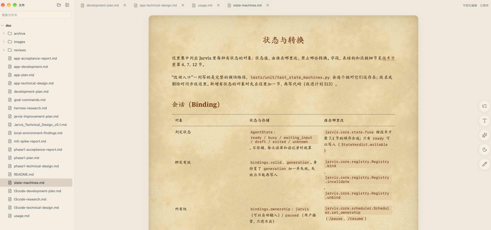
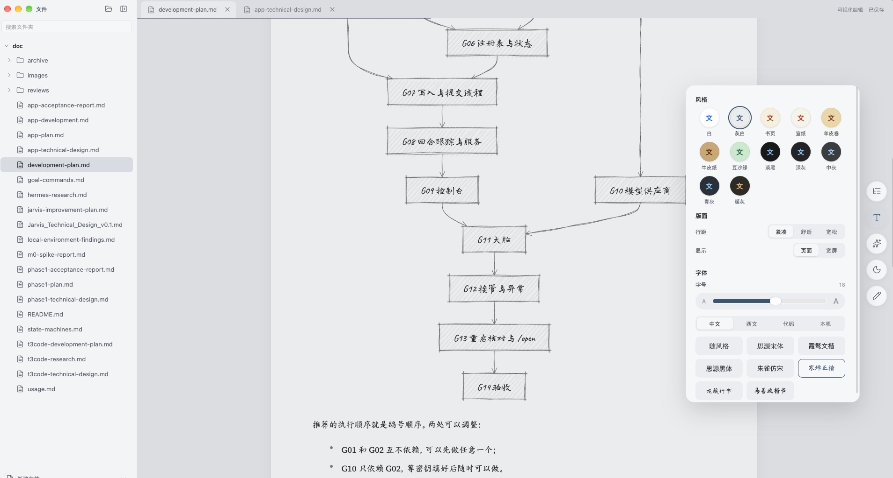

# Mino

[简体中文](README.md) · **English**

**A quiet local Markdown editor and reader for macOS on Apple Silicon.**

Opening a document is like opening a typeset book: paper texture, a proper text face and comfortable line spacing. When you want to change something, press `⌘⇧R` and edit on the typeset page itself. Mino also reads plain text, source files and PDFs. It is offline by default; your documents stay on your Mac.

It is for people who write notes, manuscripts and technical documents in Markdown and want to read them as books, and it takes particular care with Chinese text.



> **Current version: v1.0.0** (2026-11-20, [changelog](CHANGELOG.en.md)). The features are complete, the automated tests pass and the author uses it daily. Native behavior (opening from Finder, Chinese input methods, PDF export and printing, performance) has not yet been checked item by item on a device. There is no download: you build it from source, and the resulting `.app` is unsigned and not notarized. Keep a copy of important documents.

[Features](#what-it-does) · [Diagrams](#diagrams) · [Safety and privacy](#your-documents-are-safe) · [Build and run](#build-and-run-from-source) · [Shortcuts](#shortcuts) · [Limits](#limits) · [Development](#development)

The interface is available in Simplified Chinese and English; the screenshots show the Chinese one.

## What it does

**Writing**
- WYSIWYG editing (built on Milkdown/Crepe): headings, lists, tasks, quotes, tables, code blocks, links and images. You can switch to the source at any time.
- An image you paste or drop is written to an `assets/` folder beside the document when you save, and the Markdown holds only the relative path.
- Text transforms: spaces between Chinese and Western text, full-width or half-width punctuation, letter case.
- Content that cannot be edited visually without risk, such as math and directives, opens in a source-protected mode: a sanitized preview is shown and the file is saved exactly as it was.

**Reading**
- A document opened from Finder or the sidebar starts in reading mode: the editing controls are hidden, progress is shown, Space turns the page, and a click enlarges an image.
- Twelve reading styles: White, Off-white, Book Page, Xuan Paper, Parchment, Kraft and Soft Green, and five night styles. They can follow the system appearance.
- Chinese, Western and code fonts are chosen separately. Bundled and usable offline: Source Han Serif, LXGW WenKai, Source Han Sans, Zhuque Fangsong, ChillKai, Long Cang and Ma Shan Zheng; Source Serif, Literata, EB Garamond and Inter; JetBrains Mono, Fira Code and Source Code Pro. Fonts installed on your Mac can be used too.
- Line width, paragraph spacing, first-line indent and table style are adjustable; number columns align right, and a mostly-Western document gets Western layout.
- Code highlighting comes in seven color schemes, or in colors you set role by role, kept separately for day and night.
- Pinch on the trackpad to zoom the page. The settings are a window of their own, so they can sit on another display while you watch the document change.



### Diagrams

A Mermaid code block is drawn as a diagram, in one of eight looks: On the Page, Architecture, Marker, Pencil, Chalk, Sci-fi, Fountain Pen and Colorful. Within a look you can change the color scheme, the label font, and the pattern and routing of the edges. Exported HTML and PDF use the same choices.

- In the hand-drawn looks (Marker, Pencil, Chalk, Fountain Pen) lines waver and overshoot their corners, and a redraw is always identical. Labels can be set in a running or a brush-written regular script.
- `:name:` in a label inserts an icon; cloud, burst and bare-text nodes are drawn as remarks.
- A diagram always fits the page width and never scrolls sideways. In reading mode a click opens it in a viewer, fitted to the window.

| Chalk | Fountain Pen |
| --- | --- |
|  |  |

**Managing files**
- The sidebar holds several folders at once, with full-text search, new file, rename, move by dragging, and move to Trash. Moving a Markdown file takes the images it refers to along.
- Tabs and windows: drag a tab out of the window to give it a window of its own.
- Documents, tabs and the sidebar have context menus. With text selected, the menu offers formatting, Copy as Markdown, Find and the AI actions.

**More than Markdown**
- Plain text (`.txt`, `.log` and others): UTF-8, UTF-16, GB18030 and Big5 are recognized, and the file is saved in the encoding it had.
- Source and configuration files (JSON, YAML, TOML, Python, Rust, Swift, Go, Shell and dozens more): syntax highlighting and line numbers; CSV and TSV can be shown as tables.
- PDF: read-only, with zoom, text selection, the bookmark outline, find, and the page you were on remembered.

**Export and print**
- Markdown with its image folder, Markdown text only, or self-contained HTML that carries the export style and the fonts it needs and loads nothing remote.
- Export PDF: every page is filled with the paper color of the export style, night styles included; text can be selected and links work. The export style is "current style" or "plain white", chosen in the settings.
- Print (`⌘P`) uses the system print panel. It is print-friendly (white, to save ink) by default and can be set to match the screen.

**AI assistant (optional, off by default)**
- For the whole document: summary, key points, key concepts, background, or a question of your own.
- For selected text: explain, translate, rewrite, continue.
- Works with DeepSeek, OpenAI and other OpenAI-compatible services, with your own API key.

## Your documents are safe

- **Offline by default.** With AI off, the app sends no network requests. Fonts, paper textures and highlighting data are installed with it.
- **Saving cannot damage the file.** Writes are atomic, and the previous version is kept as a hidden backup beside the file. If the file changed on disk, you are told of the conflict and can look at the differences first; your unsaved changes are never overwritten.
- **An unexpected quit is recoverable.** Unsaved edits are written to a draft, and the next launch offers to restore it.
- **The interface has no file or network access.** All disk access goes through the Rust side, and only to files you granted through a dialog, a drop or Finder.
- **AI goes online only after you agree.** Once you turn it on and consent in the settings, the text you submit is sent to the service you configured. The key is kept in the macOS Keychain and only the Rust process makes the request. Your key pays for the usage, and an answer may be wrong.

## Build and run from source

You need:

- A Mac with Apple Silicon. The bundle declares macOS 12.0 as its minimum, but it has only been built and used on macOS 27; earlier versions are unverified.
- arm64 builds of Node.js ≥ 22 (`.nvmrc` pins 22.23.2) and Rust, and the Xcode Command Line Tools.

```sh
git clone https://github.com/bingghost-ci/MinoMarkdown.git
cd MinoMarkdown
npm ci --no-audit --no-fund
npm run archcheck   # confirms Node, Rust and the Tauri CLI are arm64
./install.sh        # builds the release, installs it to /Applications and opens it, then removes build output
```

`./install.sh` first runs `./build.sh` for a clean release build, then installs `Mino.app` to `/Applications` (replacing an installed copy; a running Mino is asked to quit, and you can save in its prompt), opens it, and finally runs `./clean.sh` to remove all build output. It changes no version, and does not commit or push. To get the package without installing it, run `./build.sh`: the output is `src-tauri/target/release/bundle/macos/Mino.app` and a ZIP in `dist-package/`.

### First use

1. The app starts with an empty untitled document. Type, then press `⌘S` and choose where to save.
2. Press `⌘O` to open a `.md` file, or drag a file or folder in from Finder: a document opens in reading mode, and a folder appears in the sidebar.
3. Press `⌘⇧R` to edit, and `⌘S` to save. Images in the text are saved in `assets/` beside the document.
4. Choose a reading style and fonts in Settings… (`⌘,`) in the app menu. A change shows at once.

## Shortcuts

| Action | Shortcut |
| --- | --- |
| New document / new window | `⌘N` / `⌘⇧N` |
| Open file / open folder | `⌘O` / `⌘⇧O` |
| Save / Save As / close tab | `⌘S` / `⌘⇧S` / `⌘W` |
| Switch between reading and editing | `⌘⇧R` |
| Find and replace | `⌘F` |
| Body text / heading 1–6 | `⌘⌥0` / `⌘⌥1`–`⌘⌥6` |
| Bold / italic / strikethrough / inline code / link | `⌘B` / `⌘I` / `⌘⌥X` / `⌘E` / `⌘K` |
| Bullet list / numbered list / quote / code block | `⌘⌥8` / `⌘⌥7` / `⌘⇧B` / `⌘⌥C` |
| Larger / smaller / reset text size | `⌘=` / `⌘-` / `⌘0` |
| Print / settings | `⌘P` / `⌘,` |

Export (Markdown, plain text, HTML, PDF), source mode, and the toolbar, sidebar and outline switches are in the menu bar and have no default shortcut.

## Limits

- A document may be up to 20 MiB, a PDF up to 200 MiB, and an image up to 20 MiB or 40 million pixels. Markdown over 2 MiB opens source-protected.
- A document of 200,000 characters or more that opens in reading mode shows its beginning first, and is loaded into the editor only when you start editing.
- PDFs are read-only; scripts in them do not run, and there is no OCR. An exported PDF has no header or page numbers, and the paper texture is not exported (only its color).
- The sidebar has no permanent delete, and cannot rename or delete a folder that is not empty.
- Drafts are saved at intervals, so the last few seconds of typing may be lost in a sudden power cut.
- A local build is unsigned, so macOS may ask for Keychain access again after a rebuild.

The fuller account of risks and the verification state of each feature is in the [progress record](doc/06-开发进度.md) and the [acceptance steps](doc/05-验收与发布.md) (both in Chinese). What changed in each version is in the [changelog](CHANGELOG.en.md).

## Development

```sh
npm run typecheck                                       # TypeScript check
npm run test                                            # Vitest tests
cargo test --lib --manifest-path src-tauri/Cargo.toml   # Rust tests
./start.sh                                              # development: Vite hot reload and a debug build of the app (Ctrl-C to stop)
./build.sh                                              # clean release build and ZIP; never changes the version
./install.sh                                            # build.sh, install to /Applications, open, then clean.sh
npm run dev                                             # the interface alone in a browser (no Rust commands)
./clean.sh                                              # remove debug and release output, packages and leftover test folders; keeps node_modules (--deps removes it, --dry-run only lists)
```

Built with Tauri 2 (Rust), React 19, TypeScript, Milkdown/Crepe, CodeMirror, PDF.js and Mermaid. [CLAUDE.md](CLAUDE.md) describes the code structure, the module boundaries and the conventions, including which shared functions to look for before writing a new one. The product plan, technical design and development plan are in Chinese and start at the [document index](doc/README.md).

## License

The project's own license has not been decided. The licenses of third-party dependencies are listed for [npm packages](doc/evidence/dependency-licenses.tsv), [Rust crates](doc/evidence/rust-dependency-licenses.tsv) and the [bundled fonts](doc/evidence/bundled-font-licenses.tsv); the check of the license texts is recorded in the [T28 license audit](doc/evidence/T28-license-text-audit.md).
