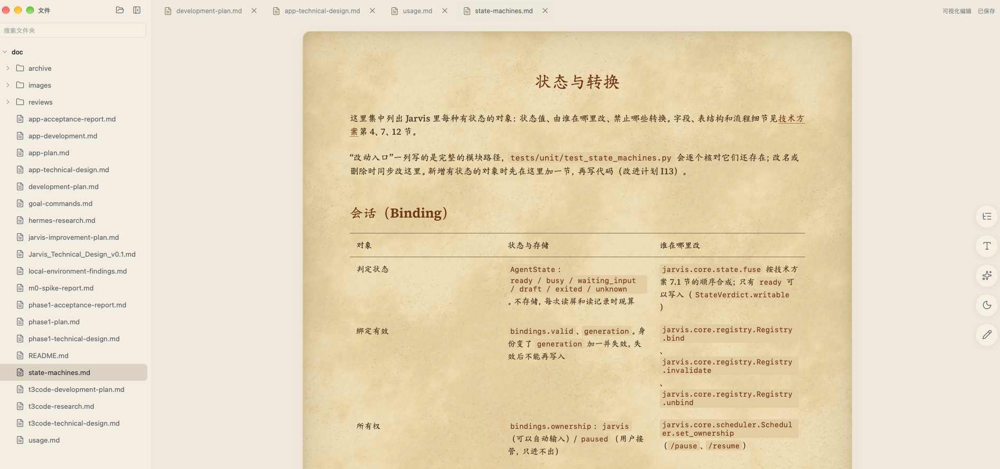
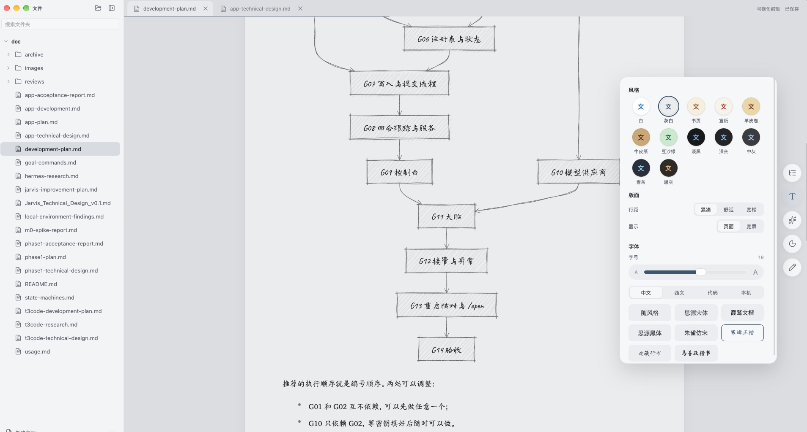

<p align="center"></p>

<h1 align="center">Mino</h1>

<p align="center"><b>简体中文</b> · <a href="README.en.md">English</a></p>

**AI 时代，Markdown 文档越写越多，也该有一个读起来舒服的地方。**

方案、报告、读书笔记、技术文档——AI 生成的内容几乎都是 Markdown。它们越来越多、越来越长，可大多数时候我们只能在编辑器里看带符号的源码，或者在预览窗口里读一页朴素的网页。Mino 是一个本地的 Markdown 阅读器和编辑器，它把功夫下在“读”上，让这些文档像一本排好版的书：

- **为阅读排版**：16 种阅读风格（白、灰白、高对比、陶土、书页、宣纸、羊皮卷、牛皮纸、豆沙绿，以及 7 种夜间风格），带纸张纹理，另有学术、公文、技术、打字机等版式可与纸张任意搭配；中文、西文、代码字体分开选，内置思源宋体、霞鹜文楷等 14 款字体，离线可用；行宽、段距、首行缩进可调，以西文为主的文档自动换成西文排版。
- **图表和代码同样讲究**：Mermaid 图表有 8 种画风，包括马克笔、铅笔、粉笔、钢笔几种手绘风格；代码高亮有 7 套配色，也可以自己逐项配色。
- **读到哪里，改到哪里**：按 `⌘⇧R` 就在排好版的页面上直接编辑，所见即所得；粘贴的图片保存时自动放进文档旁的 `assets/`。
- **不只是 Markdown**：共支持 55 种扩展名——Markdown；纯文本，自动识别 UTF-8、UTF-16、GB18030、Big5 编码；JSON、YAML、Python、Rust、Swift 等 50 种源码和配置文件，带高亮和行号，CSV/TSV 可显示成表格；以及只读的 PDF。
- **默认离线**：AI 助手是唯一会联网的功能，默认关闭；你的文档只留在你自己的电脑上。

> **平台**：Mino 基于 Tauri 2，前端和大部分 Rust 代码本身是跨平台的，Rust 部分也为非 macOS 平台写了替代实现，理论上可以在 Windows 和 Linux 上构建。但目前**只在 Apple Silicon（M4）的 macOS 上编译和使用过**，Windows 与 Linux 从未编译过，构建脚本也只接受 arm64 的 Mac。导出 PDF 与打印、用钥匙串保存 API 密钥、列出系统字体、Finder 集成等是 macOS 专用实现，换到其他平台会缺失或降级。



> **当前版本：v1.1.0**（2026-11-21，[发布日志](CHANGELOG.md)）。功能已经完整，自动化测试通过，作者日常在用；但 Finder 打开、中文输入法、导出 PDF 与打印、性能等原生行为还没有逐项做完实机验收。没有可下载的安装包，需要从源码构建；构建出的 `.app` 未签名、未公证。重要文档请先保留副本。

[功能](#它能做什么) · [图表](#图表) · [安全与隐私](#你的文档是安全的) · [构建与运行](#从源码构建并运行) · [快捷键](#常用快捷键) · [限制](#限制) · [开发](#开发)

## 它能做什么

**写作**
- 所见即所得编辑（基于 Milkdown/Crepe）：标题、列表、任务、引用、表格、代码块、链接、图片；也可以随时切到源码模式。
- 粘贴或拖入的图片在保存时写入文档旁边的 `assets/` 文件夹，Markdown 里只记录相对路径。
- 文字转换：中英文之间加空格、标点转全角或半角、大小写转换。
- 数学公式、扩展指令这类无法安全可视化编辑的内容，会自动进入“源码保护”模式：显示净化后的预览，保存时原样写回，不会被悄悄改写。

**阅读**
- 从 Finder 或文件栏打开的文档默认进入阅读模式：隐藏编辑控件，显示阅读进度，空格翻页，点图放大。
- 16 种阅读风格：白、灰白、高对比、陶土、书页、宣纸、羊皮卷、牛皮纸、豆沙绿，以及淡黑、深灰、中灰、青灰、松林、夜蓝、暖灰七种夜间风格；可跟随系统外观自动切换。
- 五种版式（标准、学术、公文、技术、打字机）与纸张分开选择；`> [!NOTE]` 提示块、`[TOC]` 目录、引用样式、圆角框表格和专注模式。
- 中文、西文和代码字体分开选。随应用附带思源宋体、霞鹜文楷、思源黑体、朱雀仿宋、寒蝉正楷、龙藏行书、马善政楷书，以及 Source Serif、Literata、EB Garamond、Inter 等西文字体和 JetBrains Mono、Fira Code、Source Code Pro 等代码字体，离线可用；也可以用本机已装的字体。
- 行宽、段间距、首行缩进、表格样式可调；数字列自动右对齐，中英文混排自动调整版式。
- 代码高亮有七套配色，也可以逐项自定义，白天和夜间各存一套。
- 触控板双指捏合缩放页面；设置是独立窗口，可以放到另一块屏幕上边改边看。



### 图表

Mermaid 代码块直接画成图，有八种画法：纸面、架构、彩笔、铅笔、粉笔、科幻、钢笔、彩色。选好画法后，配色、标注字体、连线样式和走向都可以再改，导出的 HTML 和 PDF 用同一套。

- 手绘类的画法（彩笔、铅笔、粉笔、钢笔）线条有手抖和出头，每次重画结果相同；标注可以用行书或楷书。
- 节点文字里写 `:name:` 可以插入图标；云形、爆炸形和纯文字节点画成批注。
- 图表总是缩到页宽以内，不会横向滚动；阅读时点一下图表，在查看器里按窗口大小放大看。

| 粉笔 | 钢笔 |
| --- | --- |
|  |  |

**管理文件**
- 左侧文件栏可同时打开多个文件夹，支持在文件夹中全文搜索、新建、重命名、拖动移动、移到废纸篓；移动 Markdown 文件时，它引用的图片一起带走。
- 多标签、多窗口：把标签拖出窗口即成为独立窗口。
- 文档、标签页和文件栏都有右键菜单；选中文字后的菜单提供格式、拷贝为 Markdown、查找和 AI 操作。

**不只是 Markdown**
- 纯文本（`.txt`、`.log` 等）：自动识别 UTF-8、UTF-16、GB18030、Big5，并按原编码保存。
- 代码与配置文件（JSON、YAML、TOML、Python、Rust、Swift、Go、Shell 等数十种）：带语法高亮和行号，CSV / TSV 可显示为表格。
- PDF：只读阅读，支持缩放、选字、书签大纲、查找和记住页码。

**导出与打印**
- Markdown + 图片文件夹、只含正文的 Markdown、自包含的 HTML（套用导出风格并内嵌所需字体，不加载任何远程资源）。
- 导出 PDF：整页铺满导出风格的底色（包括夜间风格），文字可选中、链接可点击。导出风格在设置中选择“当前风格”或“简洁白底”。
- 打印（`⌘P`）走系统打印面板，默认“打印友好”（白底省墨），也可在设置里改为与屏幕一致。

**AI 助手（可选，默认关闭）**
- 对全文：摘要、要点、关键概念、背景解读，或自由提问。
- 对选中文字：解释、翻译、改写、续写。
- 支持 DeepSeek、OpenAI 及其他 OpenAI 兼容服务，使用你自己的 API 密钥。

## 你的文档是安全的

- **默认离线。** 不开启 AI 时，应用不发出任何网络请求；字体、纸张纹理和代码高亮资源全部随应用安装。
- **保存不会损坏原文件。** 采用原子写入，并在文件旁保留上一版本的隐藏备份；磁盘上的文件被外部修改时会提示冲突，可以查看差异再决定，绝不直接覆盖你未保存的修改。
- **意外退出能找回。** 未保存的编辑会自动写入草稿，下次启动时提示恢复。
- **界面没有文件和网络权限。** 所有磁盘访问都经过 Rust 端，只能访问你通过对话框、拖入或 Finder 授权的文件。
- **AI 只在你同意后联网。** 在设置里主动开启并同意后，才会把你提交的正文或选中文字发送到你配置的服务。密钥存放在 macOS 钥匙串，网络请求只由 Rust 进程发出。费用由你的密钥承担，AI 的回答可能不准确。

## 从源码构建并运行

需要：

- 搭载 Apple Silicon 的 Mac。安装包声明最低支持 macOS 12.0，但目前只在 macOS 27 上构建和使用过，更低版本未验证。
- arm64 版的 Node.js ≥ 22（`.nvmrc` 固定为 22.23.2）、Rust，以及 Xcode Command Line Tools。

```sh
git clone https://github.com/bingghost-ci/MinoMarkdown.git
cd MinoMarkdown
npm ci --no-audit --no-fund
npm run archcheck   # 确认 Node、Rust 和 Tauri CLI 都是 arm64
./install.sh        # 构建 release 包，安装到“应用程序”并打开，最后清理编译产物
```

`./install.sh` 会先调用 `./build.sh` 做一次干净的 release 构建，再把 `Mino.app` 安装到 `/Applications`（替换已安装的版本；若 Mino 正在运行，会先请它正常退出，你可以在提示里保存文档），然后打开它，最后调用 `./clean.sh` 删除全部编译产物。它不改版本号，也不提交或推送。只想得到安装包而不安装时，运行 `./build.sh`，产物是 `src-tauri/target/release/bundle/macos/Mino.app` 和 `dist-package/` 里的 ZIP。

### 第一次使用

1. 应用启动后是一篇空白的“未命名”文档，可以直接输入，`⌘S` 选择位置保存。
2. 用 `⌘O` 打开一个 `.md` 文件，或把文件、文件夹从 Finder 拖进窗口：文档以阅读模式打开，文件夹出现在左侧文件栏。
3. 按 `⌘⇧R` 切换到编辑，改完 `⌘S` 保存；文中图片会保存在文档旁边的 `assets/` 里。
4. 在应用菜单的“设置…”（`⌘,`）里挑选阅读风格和字体，切换立即生效。

## 常用快捷键

| 操作 | 快捷键 |
| --- | --- |
| 新建文档 / 新建窗口 | `⌘N` / `⌘⇧N` |
| 打开文件 / 打开文件夹 | `⌘O` / `⌘⇧O` |
| 保存 / 另存为 / 关闭标签 | `⌘S` / `⌘⇧S` / `⌘W` |
| 阅读模式与编辑切换 | `⌘⇧R` |
| 查找和替换 | `⌘F` |
| 正文 / 标题 1–6 | `⌘⌥0` / `⌘⌥1`–`⌘⌥6` |
| 加粗 / 斜体 / 删除线 / 行内代码 / 链接 | `⌘B` / `⌘I` / `⌘⌥X` / `⌘E` / `⌘K` |
| 无序列表 / 有序列表 / 引用 / 代码块 | `⌘⌥8` / `⌘⌥7` / `⌘⇧B` / `⌘⌥C` |
| 放大 / 缩小 / 恢复文字大小 | `⌘=` / `⌘-` / `⌘0` |
| 打印 / 设置 | `⌘P` / `⌘,` |

导出（Markdown、纯文本、HTML、PDF）、源码模式、工具栏、文件栏和大纲的开关在菜单栏中，没有默认快捷键。

## 限制

- 单篇文档上限 20 MiB，PDF 上限 200 MiB，单张图片上限 20 MiB 或 4000 万像素。Markdown 超过 2 MiB 时进入源码保护模式。
- 20 万字以上的文档以阅读模式打开时会先显示开头，开始编辑时才载入编辑器。
- PDF 只读，不执行其中的脚本，不做 OCR。导出的 PDF 没有页眉和页码，纸张纹理不会导出（只有底色）。
- 文件栏不提供永久删除，也不能重命名或删除非空文件夹。
- 草稿按间隔保存，突然断电时最后几秒的输入可能来不及写入。
- 本地构建未签名，重新构建后 macOS 可能再次询问钥匙串授权。

更完整的风险说明和每项功能的验证状态见[开发进度](doc/06-开发进度.md)和[验收步骤](doc/05-验收与发布.md)；各版本的变化见[发布日志](CHANGELOG.md)。

## 开发

```sh
npm run typecheck                                       # TypeScript 检查
npm run test                                            # Vitest 测试
cargo test --lib --manifest-path src-tauri/Cargo.toml   # Rust 测试
./start.sh                                              # 开发调试：启动 Vite 热更新和 debug 版应用（Ctrl-C 结束）
./build.sh                                              # 干净地编译 release 包和 ZIP，不改版本号
./install.sh                                            # build.sh → 安装到 /Applications → 打开 → clean.sh
npm run dev                                             # 只在浏览器里预览界面（没有 Rust 命令）
./clean.sh                                              # 删除 debug 和 release 编译产物、安装包和测试遗留的临时目录；保留 node_modules（--deps 一起删，--dry-run 只列出）
```

技术栈：Tauri 2（Rust）、React 19、TypeScript、Milkdown/Crepe、CodeMirror、PDF.js、Mermaid。代码结构、模块边界和开发约定见 [CLAUDE.md](CLAUDE.md)，其中“Reuse”一节和[代码复用整改](doc/10-代码复用整改.md)说明了写新代码前该先找哪些现成的函数；产品方案、技术设计和开发计划（中文）从[文档目录](doc/README.md)开始阅读。

## 许可

Mino 以 [MIT 许可](LICENSE)发布。随附的字体和第三方依赖按各自的许可（字体如 SIL OFL 1.1），不在 MIT 范围内。第三方依赖的许可清单见 [npm 依赖](doc/licenses/dependency-licenses.tsv)、[Rust 依赖](doc/licenses/rust-dependency-licenses.tsv)和[随附字体](doc/licenses/bundled-font-licenses.tsv)；许可原文的核对情况见 [许可原文审查](doc/licenses/license-text-audit.md)。

## 开发中使用的 AI 模型

本项目的代码在 AI 编程助手的协助下完成，使用过的模型：Claude Fable 5.2、Claude Opus 5.5、GPT SOL 6.1、Astra 6.2。
