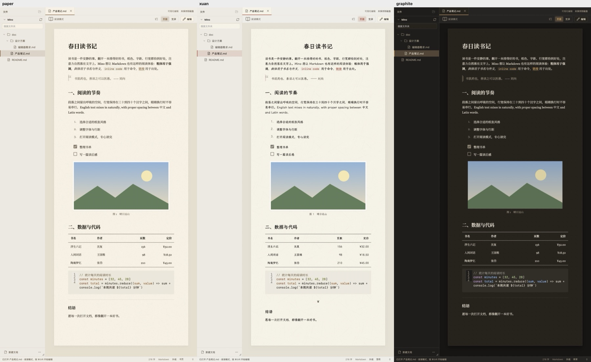
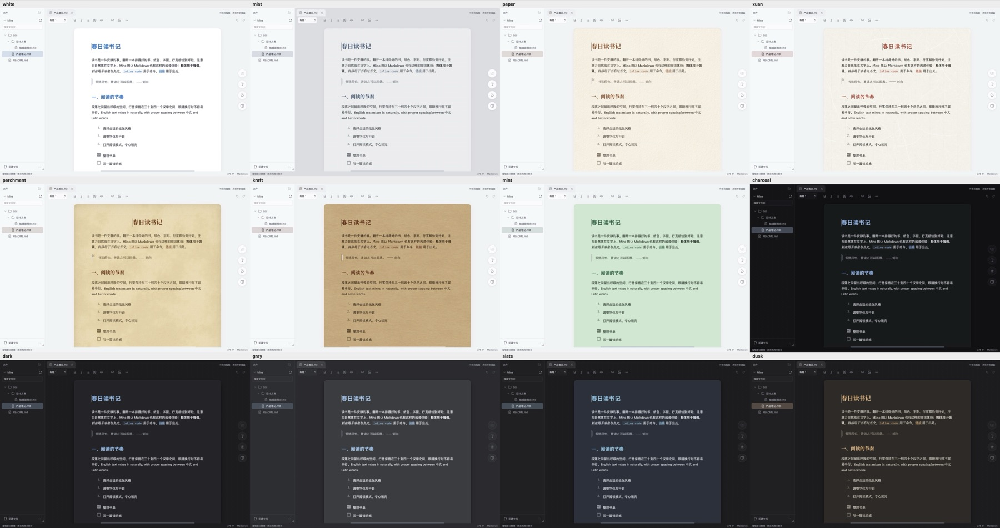

# Mino

**一个安静的本地 Markdown 编辑器与阅读器，专为 Apple Silicon 上的 macOS 设计。**

打开文档就像翻开一本排好版的书：有纸张质感、中文书宋和舒服的行距；想改的时候，按一下就能直接在排版好的页面上编辑。它也能阅读纯文本、代码文件和 PDF。默认完全离线，你的文档只留在你的 Mac 上。



> **当前状态：v0.1.0 本地测试版。** 功能代码和自动化测试已完成，但大部分原生行为（Finder 打开、中文输入法、打印 PDF、性能等）还在等待集中实机验证。没有可下载的安装包，需要从源码构建；构建出的 `.app` 未签名、未公证。重要文档请先保留副本。

## 它能做什么

**写作**
- 所见即所得编辑（基于 Milkdown/Crepe）：标题、列表、任务、引用、表格、代码块、链接、图片，一键切到源码模式。
- 粘贴或拖入的图片在保存时写入文档旁边的 `assets/` 文件夹，Markdown 里只记录相对路径。
- 数学公式、扩展指令这类无法安全可视化编辑的内容，会自动进入“源码保护”模式：显示净化后的预览，保存时原样写回，不会被悄悄改写。

**阅读**
- 从 Finder 或文件栏打开的文档默认进入阅读模式：隐藏编辑控件，显示阅读进度，空格翻页，点图放大。
- 12 种阅读风格：白、灰白、书页、宣纸、羊皮卷、牛皮纸、豆沙绿，以及淡黑、深灰、中灰、青灰、暖灰五种夜间风格；可跟随系统外观自动切换。
- 中文、西文和代码字体分开选。随应用附带思源宋体、霞鹜文楷、思源黑体、朱雀仿宋、寒蝉活宋，以及 Source Serif、Literata、EB Garamond、Inter、JetBrains Mono 等西文和代码字体，离线可用；也可以用本机已装的字体。
- 代码高亮、Mermaid 图表、数字列自动右对齐、中英文混排自动调整版式。



**管理文件**
- 左侧文件栏可同时打开多个文件夹，支持在文件夹中全文搜索、新建、重命名、移到废纸篓。
- 多标签、多窗口：把标签拖出窗口即成为独立窗口。
- 文档、标签页和文件栏都有右键菜单；选中文字后的菜单提供格式、拷贝为 Markdown、查找和 AI 操作。

**不只是 Markdown**
- 纯文本：自动识别 UTF-8、UTF-16、GB18030、Big5，并按原编码保存。
- 代码与配置文件：带语法高亮和行号，CSV / TSV 可显示为表格。
- PDF：只读阅读，支持缩放、选字、书签大纲、查找和记住页码。

**导出**
- Markdown + 图片文件夹、只含正文的 Markdown、自包含的 HTML（套用当前阅读风格并内嵌所需字体），以及通过系统打印对话框存储为 PDF。

## 你的文档是安全的

- **默认离线。** 不开启 AI 时，应用不发出任何网络请求；字体、纸张纹理和代码高亮资源全部随应用安装。
- **保存不会损坏原文件。** 采用原子写入，并在文件旁保留上一版本的隐藏备份；磁盘上的文件被外部修改时会提示冲突，可以查看差异再决定，绝不直接覆盖你未保存的修改。
- **意外退出能找回。** 未保存的编辑会自动写入草稿，下次启动时提示恢复。
- **界面没有文件和网络权限。** 所有磁盘访问都经过 Rust 端，只能访问你通过对话框、拖入或 Finder 授权的文件。
- **AI 助手是可选的。** 默认关闭。在设置里主动开启并同意后，才会把你提交的正文或选中文字发送到你配置的服务（DeepSeek、OpenAI 或其他兼容服务）。密钥存放在 macOS 钥匙串，网络请求只由 Rust 进程发出。费用由你的密钥承担，AI 的回答可能不准确。

## 从源码构建并运行

需要：

- 搭载 Apple Silicon 的 Mac。安装包声明最低支持 macOS 12.0，但目前只在 macOS 27 上构建和使用过，更低版本未验证。
- arm64 版的 Node.js ≥ 22（`.nvmrc` 固定为 22.23.2）、Rust，以及 Xcode Command Line Tools。

```sh
git clone https://github.com/bingghost-ci/MinoMarkdown.git
cd MinoMarkdown
npm ci --no-audit --no-fund
npm run archcheck   # 确认 Node、Rust 和 Tauri CLI 都是 arm64
./start.sh          # 构建并打开 Mino
```

`./start.sh` 会做一次干净的 release 构建，然后打开 `src-tauri/target/release/bundle/macos/Mino.app`。如果 Mino 已在运行，请先退出再执行。只想构建不打开时，使用 `./build.sh`。

第一次使用：

1. 应用启动后是一篇空白的“未命名”文档，可以直接输入。
2. 用 `⌘O` 打开一个 `.md` 文件，或把文件、文件夹从 Finder 拖进窗口；文档会以阅读模式打开。
3. 按 `⌘⇧R` 切换到编辑，`⌘S` 保存；在应用菜单的“设置…”（`⌘,`）里挑选阅读风格和字体。

## 常用快捷键

| 操作 | 快捷键 |
| --- | --- |
| 新建文档 / 新建窗口 | `⌘N` / `⌘⇧N` |
| 打开文件 / 打开文件夹 | `⌘O` / `⌘⇧O` |
| 保存 / 另存为 | `⌘S` / `⌘⇧S` |
| 阅读模式与编辑切换 | `⌘⇧R` |
| 查找和替换 | `⌘F` |
| 加粗 / 斜体 / 行内代码 / 链接 | `⌘B` / `⌘I` / `⌘E` / `⌘K` |
| 放大 / 缩小 / 恢复文字大小 | `⌘=` / `⌘-` / `⌘0` |
| 打印 / 存储为 PDF | `⌘P` |

## 限制

- 单篇文档上限 20 MiB，PDF 上限 200 MiB，单张图片上限 20 MiB 或 4000 万像素。Markdown 超过 2 MiB 时进入源码保护模式。
- 20 万字以上的文档以阅读模式打开时会先显示开头，开始编辑时才载入编辑器。
- PDF 只读，不执行其中的脚本，不做 OCR。导出的 PDF 没有页眉和页码。
- 文件栏不提供永久删除，也不能重命名或删除非空文件夹。
- 草稿按间隔保存，突然断电时最后几秒的输入可能来不及写入。
- 本地构建未签名，重新构建后 macOS 可能再次询问钥匙串授权。

更完整的风险说明和每项功能的验证状态见[开发进度](doc/06-开发进度.md)和[验收步骤](doc/05-验收与发布.md)。

## 开发

```sh
npm run typecheck                                       # TypeScript 检查
npm run test                                            # Vitest 测试
cargo test --lib --manifest-path src-tauri/Cargo.toml   # Rust 测试
npm run tauri -- dev                                    # 开发模式运行桌面应用
npm run dev                                             # 只在浏览器里预览界面（没有 Rust 命令）
```

技术栈：Tauri 2（Rust）、React 19、TypeScript、Milkdown/Crepe、CodeMirror、PDF.js。代码结构、模块边界和开发约定见 [CLAUDE.md](CLAUDE.md)；产品方案、技术设计和开发计划（中文）从[文档目录](doc/README.md)开始阅读。

> **注意 `./install.sh`：** 它会把版本号加 1、安装到 `/Applications`、提交版本文件、打标签并推送到远程，最后删除 `src-tauri/target` 下的构建输出。只在准备发布新版本时使用。

## 许可

项目自身的许可尚未确定。第三方依赖的许可清单见 [npm 依赖](doc/evidence/dependency-licenses.tsv)、[Rust 依赖](doc/evidence/rust-dependency-licenses.tsv)和[随附字体](doc/evidence/bundled-font-licenses.tsv)；许可原文的核对情况见 [T28 许可审查](doc/evidence/T28-license-text-audit.md)。
