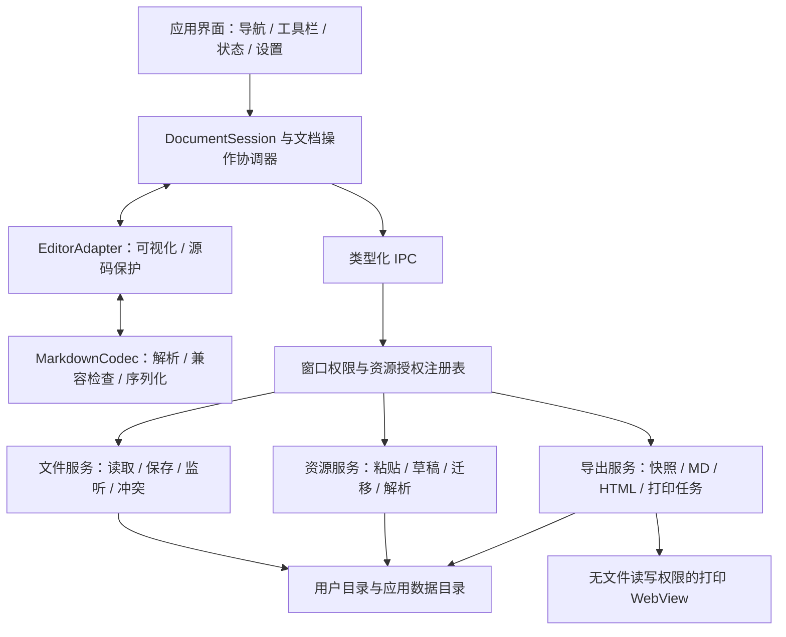

# Mino 技术设计

版本：v0.1 · 日期：2026-11-06 · 上游：[产品方案](01-产品方案.md)。

本文定义计划中的架构和实现契约。路径、类型、命令均待开发；没有实际构建或运行结论。

## 1. 技术基线与选型门槛

| 层 | 方案基线 | 选择理由 | 验证要求 |
| --- | --- | --- | --- |
| 桌面 | Tauri 2、Rust、macOS 系统 WebView | 原生文件能力与前端编辑分离 | T01 固定精确依赖，T04/T05 验证实际桌面链路 |
| 界面 | React + TypeScript + Vite，普通 CSS 变量 | 组件化管理文件导航、工具栏和会话 | 不引入服务端渲染、路由服务器或重型 UI 框架 |
| 编辑 | Milkdown/Crepe，封装 `EditorAdapter` | 支持结构化可视化编辑，应用服务不绑定具体内核 | T03 验证 IME、选区、撤销、GFM 和 TopBar |
| Markdown | Milkdown 解析链与共享 remark/unified 管线 | 支持语法、导出、资源解析共用规则 | 仅启用语法白名单，保留原文与不支持内容 |
| 源码保护 | 首版使用可访问的纯文本编辑器 | 未知语法仍可保留与编辑 | 不要求复杂 IDE；与可视化切换显式做兼容检查 |
| 本地服务 | Rust 命令、授权注册表、文件/资源/导出服务 | 统一校验与错误处理 | WebView 不直接获得任意路径读写接口 |
| 应用数据 | 版本化 JSON 设置、草稿目录与事务日志 | 正文继续使用普通 `.md` 文件 | 不使用专有正文数据库 |
| PDF | 正文专用打印 WebView + 系统打印对话框 | 对应产品 D05 | T05 实机验证；打开对话框不等于 PDF 写入成功 |
| 检查 | TypeScript/Vitest 类工具、Rust 单元/集成、浏览器组件、macOS 实机 | 分层验证业务契约 | 工具与版本由 T01 固定，原生证据不能由浏览器结果替代 |

Crepe 官方文档和源码列有默认关闭的 TopBar；网页主分支能力不代表任意已发布包都具备。T01 必须检查所安装发行包，T03 再验证交互；不可用时由应用实现工具栏，调用统一适配器。[Crepe 文档](https://milkdown.dev/docs/api/crepe)，[官方功能定义](https://github.com/Milkdown/milkdown/blob/main/packages/crepe/src/feature/index.ts)。

Tauri 的插件 capability 不会自动替所有应用自定义命令完成授权。应显式限制自定义命令所属窗口，并在 Rust 服务内校验资源令牌与路径。[官方 capabilities](https://v2.tauri.app/security/capabilities/)。

具体依赖版本不在本次规划中推断。T01 生成锁文件和 `doc/evidence/dependency-baseline.md`，记录 Node、包管理器、Rust toolchain、Tauri、Milkdown、系统版本、CPU 架构、许可证和来源。T06 记录经过验证的版本组合；升级后重跑受影响样本。

## 2. 总体架构



职责约束：React 不维护另一份可覆盖编辑器的受控正文；编辑器事务是当前内容来源，Session 管理生命周期与修订号；文件服务是落盘入口；资源服务掌握最终路径；导出读取不可变快照。打印页只接收已净化的作业内容，不能访问编辑会话或任意文件命令。

## 3. 计划代码结构

```text
MinoMarkdown/
├── Markdown编辑器.md                 # 原始输入，保留
├── doc/                             # 本套方案、计划、证据索引
│   └── evidence/                    # 后续任务产生的脱敏证据
├── src/
│   ├── app/                         # 启动、菜单、系统事件、错误边界
│   ├── components/                  # 通用交互组件
│   ├── features/
│   │   ├── workspace/               # 目录树、文件操作
│   │   ├── document/                # 会话与操作协调器
│   │   ├── editor/                  # 适配器、工具栏、输入规则
│   │   ├── assets/                  # 图片占位、状态与替代文本
│   │   ├── export/                  # 选择导出与结果展示
│   │   └── settings/                # 主题、最近使用与设置
│   ├── core/
│   │   ├── markdown/                # 白名单、兼容检查、序列化与渲染
│   │   ├── snapshot/                # 快照与资源清单
│   │   └── contracts/               # IPC 类型、错误与事件
│   ├── platform/                    # IPC 客户端；测试替身与桌面实现分离
│   └── styles/                      # tokens、正文、编辑、打印
├── src-tauri/
│   ├── src/
│   │   ├── commands/                # 对话框、文档、目录、资源、导出命令
│   │   ├── services/                # 业务校验、任务与会话注册表
│   │   ├── fs/                      # 原子写、revision、watch、协调与恢复
│   │   ├── assets/                  # 图片验证、存储、迁移与读取
│   │   ├── export/                  # 目标提交、资源 manifest 与打印调度
│   │   ├── security/                # grant、令牌、路径和 URL 策略
│   │   └── platform/macos/          # 文件协调、剪贴板、废纸篓、系统入口
│   ├── capabilities/               # main 与 print 权限隔离
│   ├── permissions/                # 应用自定义命令权限
│   └── tests/                      # 文件、故障、IPC 与授权集成检查
├── tests/
│   ├── fixtures/markdown/           # 合法、边界、未知语法及原始字节样本
│   ├── fixtures/assets/             # 合成图片、坏图片、中文路径
│   ├── unit/                       # codec、session、快照
│   ├── integration/                # 编辑器、资源、导出契约
│   └── native/                     # macOS 实机步骤与记录模板
└── scripts/                        # 检查、样本和本地打包入口
```

M0 原型通过后应抽取并复用正式模块，删除重复实现。不要长期保留绕过正式服务的演示写文件入口。

## 4. 状态与数据契约

### 4.1 核心类型草案

以下为逻辑契约，实施时可调整具体字段表达，但必须保持语义。

```typescript
type EditorMode = 'visual' | 'source-protected';
type DiskRevision = {
  contentHash: string; // 原始磁盘字节的 SHA-256
  byteLength: number;
  modifiedAt: string;
  fileIdentity?: string; // 平台文件身份，用于替换/重命名判断
};

type DocumentSession = {
  sessionId: string;
  generation: number; // 重新打开/替换文档时递增，拒绝旧异步回调
  documentHandle?: string; // 后端不透明句柄；无句柄表示草稿
  displayName: string;
  mode: EditorMode;
  revision: number; // 每次用户内容事务递增
  savedRevision: number;
  baseDiskRevision?: DiskRevision;
  persistence: 'idle' | 'saving' | 'failed';
  conflict?: { conflictId: string; diskRevision?: DiskRevision; deleted: boolean };
  compatibilityIssues: CompatibilityIssue[];
  draftId: string;
};

type DocumentSnapshot = {
  snapshotId: string;
  sessionId: string;
  generation: number;
  revision: number;
  mode: EditorMode;
  markdown: string; // 自包含快照中的逻辑正文，可含待解析的资源标识
  title: string;
  assetManifestId: string; // 后端固定的资源字节/草稿映射，不依赖可变当前路径
  capturedAt: string;
};

type EditorAdapter = {
  load(input: { markdown: string; mode: EditorMode }): Promise<void>;
  capture(): Promise<{ markdown: string; revision: number }>;
  execute(command: EditorCommand): void;
  getSelectionState(): SelectionState;
  insertPendingImage(operationId: string): void;
  dispose(): Promise<void>;
};
```

实际 `Snapshot` 创建必须等待组合输入提交以及该修订的待处理资源，或提示用户重试。资源清单生成后不可通过后续编辑偷偷改变；清单中包含资源内容哈希、MIME、长度与读取授权，后端在作业开始时固定资源字节或暂存副本。

`source-protected` 的快照允许保存/MD 导出；HTML/PDF 默认禁用并解释语法不受支持。可视化转换需用户显式选择并先展示兼容性结果，不把源码作为代码块悄悄导出来冒充正文渲染。

源码保护文档允许只读的应用内 Markdown 预览，不经过可视化编辑器和序列化，也不改变上述导出限制。预览使用 GFM 解析、HTML 白名单净化；原始 HTML 不执行，图片节点转为文字提示以避免未经用户操作的网络/磁盘资源读取。形如独立 `<a id="slug"></a>` 且紧邻标题的锚点只在预览树中映射为标题 ID，原始源码保持不变。用户切换“编辑源码”后修改并保存原文；预览与源码之间切换不产生内容修改。

### 4.2 状态规则

- `dirty = revision !== savedRevision`；初始化解析、载入与主题切换不产生用户修改。
- 保存 revision=N 时若用户已输入到 N+1，保存成功只把 `savedRevision` 更新到 N，仍显示未保存。
- 每个会话同一时刻只有一个写作业；后续手动保存排队合并为最新待存快照，不能乱序覆盖。
- 冲突、保存状态、资源状态彼此独立，不能用一个 `isLoading` 布尔值覆盖全部生命周期。
- 切换/关闭通过 `DocumentController`，统一等待保存或询问保存/放弃/取消；失败保留会话。
- 异步回调携带 sessionId、generation、operationId。过期图片上传/保存/监听事件不能更新新文档。
- 撤销历史在同一文档内稳定；重新加载磁盘内容或切换模式属于新历史边界，要明确提示。

## 5. IPC 与错误契约

### 5.1 命令草案

| 命令 | 主要输入 | 返回 | 约束 |
| --- | --- | --- | --- |
| `choose_open_target` | file/folder | grant + 条目元数据或 canceled | 原生对话框选择后由后端创建授权，前端不能伪造路径授权 |
| `choose_save_target` | sessionId、建议文件名、用途 | 短期 targetToken 或 canceled | 绑定具体目标及预期是否存在，不能任意复用 |
| `open_document` | grantId、entryToken | documentHandle、原文、DiskRevision | 严格 UTF-8 解码，大小检查，不自动写回 |
| `list_children` | folderHandle、directoryToken、分页参数 | 子条目 token、hasMore | 按需加载，不递归扫描整个磁盘 |
| `save_document` | handle/targetToken、snapshotId、expectedRevision | 写入 revision、字节哈希、资源映射 | 服务端重验授权与冲突；资源先成功后提交正文 |
| `rename_entry` / `trash_entry` | entryToken、合法新名字（如需） | 新条目或取消/失败 | 不接受任意目标路径；废纸篓不等于直接递归删除 |
| `write_image` | sessionId、operationId、受限二进制载荷 | assetId、预览引用、状态 | MIME/真实解码/大小/唯一命名校验 |
| `resolve_asset` | handle/snapshotId、Markdown 引用 | 受限 assetId 或 missing/denied | URL 解码、canonicalize 和资源根范围校验 |
| `capture_asset_manifest` | sessionId、revision、引用列表 | 固定 manifestId | 前端引用不能扩大后端授权 |
| `create_snapshot` | sessionId、generation、revision、Markdown、mode、manifestId | 不可变 snapshotId | 后端校验会话与资源归属，固定内容和资源，限制体积/数量 |
| `release_snapshot` | snapshotId | 释放确认 | 作业引用计数归零后回收，过期回收不能影响进行中作业 |
| `export_document` | snapshotId、format、targetToken、选项 | 作业状态与可验证输出信息 | MD/HTML 提交可校验；打印只返回 dialogOpened |
| `read_draft` / `write_draft` | draftId、revision、manifest | 草稿记录或确认 | 只读写应用自己的恢复目录 |
| `get_settings` / `update_settings` | 版本化设置字段 | 最新设置 | 白名单字段；操作栏显示偏好持久化 |

快照和载荷应有长度上限。大图片避免在多个 IPC 层反复 Base64 拷贝；T04 比较支持的二进制传输方案，冻结一种。事件使用 `document://external-change`、`assets://state`、`export://state` 的等价命名，必须携带会话/作业标识与序号。

### 5.2 统一错误

错误返回 `{ code, messageKey, operationId, retryable, safeDetails }`。前端把 code 映射为中文可操作提示，不把后端堆栈直接塞进 UI。

至少覆盖：`CANCELED`、`NOT_FOUND`、`PERMISSION_DENIED`、`OUT_OF_SCOPE`、`INVALID_ENCODING`、`UNSUPPORTED_SYNTAX`、`DOCUMENT_TOO_LARGE`、`IMAGE_TOO_LARGE`、`ASSET_WRITE_FAILED`、`DISK_FULL`、`CONFLICT`、`TARGET_EXISTS`、`EXPORT_RESOURCE_MISSING`、`PRINT_DIALOG_FAILED`、`STALE_OPERATION`、`IO_ERROR`。

用户取消不作为程序错误报警，也不显示成功。日志默认只含操作 ID、脱敏错误、时长和版本，不记录正文、剪贴板内容或完整用户路径。

## 6. Markdown 与可视化编辑

### 6.1 支持矩阵

| 内容 | 可视化编辑 | 保存策略 | 导出 |
| --- | --- | --- | --- |
| 段落、H1–H6、强调、删除线、行内代码 | 支持 | 语义保持；允许约定内的符号/空行规范化 | 三格式 |
| 有序/无序/任务列表、引用、分割线 | 支持 | 层级、起始编号和勾选状态保持 | 三格式 |
| 围栏代码、语言标记、缩进代码 | 支持，需样本通过 | 内容与语言保持，代码中不触发输入规则 | 三格式；不执行代码 |
| 链接、图片、引用式链接/图片 | 支持，需单独 round-trip | 目标、标题和资源语义保持；显示名可规范化 | 三格式，资源按清单处理 |
| 简单 GFM 表格 | 支持 | 单元格内容、转义竖线与对齐保持 | 三格式 |
| UTF-8 BOM、CRLF/LF | 编辑器内规范处理 | 未修改文件不重写；保存保留原 BOM 与换行约定 | 新导出默认 UTF-8/LF，可记录选项 |
| YAML front matter | 顶部元数据提示，不可视化改写 | 提取并原样拼回；无法安全分离则整篇源码保护 | MD 保留；HTML/PDF 默认不输出元数据 |
| 数学、脚注、原始 HTML、未知扩展 | 整篇源码保护 | 保存原始源码，不经过可视化序列化 | MD 可用；HTML/PDF 提示受限 |
| mermaid 等代码围栏 | 按普通代码块 | 不解释、不运行内容 | 显示代码，不宣称图形渲染 |

T35、T37、T38 完成后，本表的数学、mermaid 行与源码保护导出以 §15 为准。

若引用式链接或其他常见语法在锁定编辑器内不能稳定往返，T06 必须明确降级边界并评估是否仍满足首版目标；不能把所有文档都降级成源码模式后宣称可视化需求完成。

### 6.2 Codec 流程

1. Rust 读取原始字节并记录 hash、BOM、换行和权限信息；前端得到文本。
2. 兼容检查在可视化载入前执行：按启用语法解析、检测未知节点/原始 HTML/扩展，并验证源码片段覆盖，不用“正则未命中”证明所有语法可用。
3. 可视化候选执行 parse → serialize → parse，对标准化 AST 检查文字、层级、列表编号、代码、链接/图片目标和表格语义。
4. 未通过、解析异常、未覆盖片段或未知结构均进入源码保护；保留读取原文，默认不写入。
5. 通过后载入编辑器。保存只对支持的正文序列化，front matter 按原样前缀合成，落盘恢复 BOM/换行约定。
6. 没有用户修改的保存是 no-op，不对原文件进行格式整理。

兼容检查是明确支持范围的保护机制，不保证识别未来所有 Markdown 方言。新增扩展必须补样本和规则；保留原始快照与源码入口作为防线。不得用渲染 HTML 相同来代替源语义往返检查。

### 6.3 编辑事务

使用编辑器提供的事务和 schema 命令，不通过 `innerHTML`、DOM 替换或整篇重建实现加粗。React 仅订阅选区状态和保存状态；避免每个按键都重新 mount 编辑器。

输入规则覆盖原需求的标题、列表、引用、强调、代码、任务列表，支持转义；行内代码和代码块内禁用不适用规则。compositionstart–compositionend 期间禁止应用自定义规则抢占输入，异步保存/导出等待组合输入完成；不能用固定延时猜测中文输入完成。

工具栏 mousedown/focus 行为应通过编辑器选区 bookmark 与命令机制保持位置。链接弹层打开期间保存选区，确认后恢复；多级列表 Tab/Shift+Tab、表格导航、Esc 退出等在 T14 明确行为。撤销/重做包含格式、结构、粘图与删除。

## 7. 文件服务与保存

### 7.1 读取与访问范围

文件夹模式：用户所选根目录授权文档读取与受限写入；单文件模式：授权所选文件，读取其相对资源时限于文档父目录中的有效图片引用，写入只限文档自身、`assets` 与用户另选保存目标。单文件模式不因此开放任意父目录浏览或任意写文件。

引用 `../` 只有解析后仍在已授权资源根内才允许；超出范围显示占位并可由用户选择资源位置，不直接读取。所有路径解析需处理空格、中文、`#`、`%`、URL 编码、文件名大小写和 Unicode 文件系统差异；原始链接文本与实际文件路径分别保存。

不跟随超出根的符号链接。创建目标对尚不存在的末段，要校验最近已存在父目录；使用目录句柄/禁止跟随链接的系统能力减少校验与写入之间的路径替换风险。对不支持可靠安全写入的平台路径应失败退出，而非自动放宽到整个用户目录。

### 7.2 保存流程

1. `DocumentController` 固定快照 N，获取该文档写锁并记录 operationId。
2. 后端校验句柄、generation、授权、目标路径与 `expectedRevision`；若目标应当不存在，采用不覆盖现有文件的提交方式。
3. 准备快照 N 的资源计划并确保最终附件可用；资源失败则正文不提交。
4. 在目标相同目录创建唯一临时文件，写完整字节并 flush/fsync，保留所需文件权限与元数据。
5. 在平台文件协调范围内重新读取当前磁盘 hash/文件身份；与 expectedRevision 不同则保留编辑快照并返回冲突。
6. 保存可恢复的上一版本，在同卷完成原子替换；按平台能力同步目录项。不能把跨卷 move 当作原子保存。上一版本以硬链接 `.mino-backup-<文件名>-<哈希前 16 位>.bak` 留在同一目录；自 T101 起，目录项同步成功之后只保留刚被替换的那一版（1 份；方案原定用户文档 3 份，2026-11-12 用户决定只留最新的），清理失败不影响保存结果。
7. 读取提交后版本，返回新 DiskRevision 与 revision=N；UI 仅确认 N，不清除 N+1 的未保存状态。
8. 临时文件和事务日志按结果清理；失败保留可恢复记录，不覆盖原文后再笼统返回“保存失败”。

macOS 优先使用文件协调与平台替换能力，实际 API 和元数据保留策略在 T10 按锁定环境实现验证。特别检查原文件 mode、ACL/扩展属性与只读标志；无法按契约保留时应报告，不静默改变保护属性。

普通文件系统没有供所有不合作写入者共同遵守的通用“按内容哈希条件替换”。文件监听、hash 复查和 NSFileCoordinator 能降低冲突风险，不能证明对任意程序的竞态绝不丢写。保留提交前版本与本地快照；测试实际外部编辑器，记录非协作写入及网络盘/iCloud 的剩余边界。对已发现的冲突绝不直接覆盖。

### 7.3 外部变化

监听使用锁定版本的文件监听库/平台 FSEvents 适配，事件视为“需要重新检查”的提示，不能当成完整事实。原子替换、删除重建、重命名均重新 stat/hash；回到前台和保存前补做检查。

自身保存事件只有在实际内容 hash 与确认版本相同才可忽略，不能用“保存后一秒内全部忽略”。外部删除保留当前会话，给出另存入口；文档父目录失效时撤销相关资源访问。事件乱序或丢失不能把磁盘新版本误标为本次保存成功。

### 7.4 草稿恢复

按平台 AppData 保存版本化记录：`drafts/<draftId>/document.md`、`manifest.json`、`assets/`、必要的事务日志。正文事务按防抖写草稿，在 composition 完成后进行；应用退出时尽力 flush，不能只依赖正常退出事件。

草稿记录含 baseDiskRevision、正文 revision 与原目标显示信息。新窗口与重启均保持干净，草稿列表由“文件 > 恢复草稿…”按需读取，不在顶部自动插入横幅。恢复已保存文件前检查当前磁盘，不能把旧草稿自动写回新磁盘版本。损坏草稿隔离保留，保留时间/容量策略可配置，不能因为恢复失败删除最后一份数据。

## 8. 图片与资源服务

### 8.1 资源状态与命名

状态：`pending → staged/persisted`，失败为 `failed`，用户取消为 `canceled`。节点使用 operationId/assetId 关联，预览 URL 只存在于视图层。正式 Markdown 禁止持久化 `blob:`、应用内部协议或临时目录绝对路径。

持久化命名建议 `image-<UTC时间>-<随机ID>.<ext>`；创建时使用排他创建，冲突重新生成，不能仅凭秒级时间戳。保留用户替代文本，路径转义通过 AST 序列化处理，不用全局字符串替换。

### 8.2 接收与异步插入

1. 用户粘贴图片/拖入图片/点击插图时，在当前事务插入带 operationId 的占位节点。
2. 优先处理 clipboard image MIME；macOS 原生剪贴板回退只在明确粘贴操作中读取，不能后台轮询剪贴板。
3. 后端验证真实图像格式、字节长度和解码像素数；首版接收 PNG/JPEG/WebP，截图若提供 TIFF 可在本机转为 PNG，具体支持由 T04 证明。SVG 不直接进入可信 DOM。
4. 暂定上限：单图 20MiB、解码 4000 万像素；超限可操作提示。T06 根据实际截图样本调整并记录。
5. 资源先写入草稿区或目标 `assets`，成功后以无额外用户历史噪声的事务替换仍存在的同 operationId 占位。
6. 用户已撤销/删除或切换会话则不能把图片重新插入；已创建的资源暂存保留或按安全策略回收，不能删除可能共享的持久资源。
7. redo 需要恢复同一资源引用。失败节点可重试/删除，未解决的 pending/failed 不允许被当成已完成最终保存。

图片替换遵循新资源先成功、再改节点；删除节点不删除磁盘文件。剪贴板 HTML 作为不可信输入净化；其中的远程图不能自动作为本地已持久图片。

### 8.3 首次保存、另存与 MD 导出

共用 `AssetPlan`：枚举快照引用 → 后端解析授权与内容 → 生成无冲突目标 → 暂存复制 → 校验 hash → 重写快照中的 AST 引用 → 提交正文 → 最后更新会话（只对保存/另存）。

多文件不具备天然的全局原子事务，所以采用“附件先完成、正文最后提交 + 可重入日志”。失败最多留下没有被正文引用的新附件，不允许正文先指向缺失附件；只清理当前作业确定拥有的临时文件，不删除既有共享资源。

另存失败不切换活动文档，不提前修改原会话引用；成功后更新句柄、资源基准与监听。MD 导出成功也不切换当前文档或清除 dirty。重试可复用作业已验证资源，避免制造重复附件。

## 9. 导出架构

### 9.1 统一快照

保存和导出使用同样的内容捕获边界：完成组合输入，固定正文 revision 与资源 manifest。HTML/PDF 不读磁盘旧文档，不直接截取含工具栏的应用 DOM。

前端捕获内容后，依次建立资源 manifest 和后端快照记录；保存/导出只引用该 snapshotId。注册表绑定会话、generation、正文与资源归属，不接受跨会话拼接 manifest；快照有数量/体积预算、引用计数与过期回收。资源准备失败不注册为可导出的快照，取消时释放本作业占用。

快照生命周期独立于当前会话：导出进行时切换文件、继续编辑、重命名或撤销图片，不改变本次输出。作业结束才释放暂存资源。未知语法保护模式只允许可靠的 MD 输出。

### 9.2 Markdown

默认输出 `.md` + 同级 `assets/`（目标冲突时生成作业命名子目录）。保留 front matter 和原始受保护源码；对可识别图片 AST 节点改相对路径。源码保护模式无法可靠识别的扩展资源不能假装“附件齐全”，需提示仅导出原文或要求用户处理。

导出到已存在目标前通过原生保存目标确认覆盖；后台执行再检查目标 revision。先暂存资源再提交 MD，返回输出清单和 hash。可选“仅文本”需清楚提示不含图片文件。

### 9.3 HTML

使用共享语法集：Markdown → AST → 允许节点 HTML → 净化 → 完整 HTML 模板。模板带 charset、escaped title、正文样式和限制性的 CSP。禁用脚本、事件属性、iframe、危险 URL、外部 CSS、远程字体与不可信 SVG。输出不能含 `tauri:`、`asset:`、`blob:` 或内部临时路径。

将 manifest 中验证过的本地图片内嵌为正确 MIME 的 data URL。默认不自动抓取远程图；用户选择保留外链时标注依赖网络，选择离线输出时以明确占位处理或中止，不能称作图片完整的自包含文档。

默认合计嵌入资源上限暂定 100MiB，超出时说明并允许取消/改 MD 资源包；不能无界占用内存。输出使用快照标题、正文和版本化样式，不包含应用导航或用户本机绝对路径。成功后可迁移到另一目录在浏览器断网检查。

### 9.4 PDF / 打印

Tauri Rust `WebviewWindow::print()` 的官方契约是打开打印对话框，macOS 路径需要按选定版本实测；该接口不等于文件写入成功回调。[官方 Rust API](https://docs.rs/tauri/latest/tauri/webview/struct.WebviewWindow.html#method.print)。

流程：建立隔离打印作业 → 生成与 HTML 相同的净化正文 → 内嵌本地图片 → 加载受信任打印页面 → 等待 `document.fonts.ready` 和图片 decode → 打印预览就绪 → 用户发起系统打印 → 用户选 PDF 目标。

打印页使用包内固定的受信任脚本完成 ready 握手，正文只插入净化后的内容；导出 HTML 的禁脚本策略与应用打印外壳分别配置。握手绑定 snapshotId 和一次性 jobToken，未就绪不打开对话框。打印窗口不配置通用文件命令权限；如需要 ready 通知，只开放绑定本作业的最小专用命令。远程内容不作为 WebView 导航加载。

打印样式建议 `@page` A4、约 18mm 页边距，方向和纸型以系统设置为准；允许段落、长代码和长表格合理跨页，短图片保持宽度约束；不要对所有块设置 `break-inside: avoid` 导致整块溢出。代码换行策略和表头重复以实际 WebKit 输出为准。

首版可准确返回 `prepared`、`dialogOpened`、`failed`；不能可靠获知取消或最终 PDF 路径时保留 `handoffUnknown`，界面不写“已导出”。T05/T26 的验收人员需实际保存 PDF 并检查中文可选择、分页和图片。

一键直接 PDF 是后续独立任务，需重新验证原生 API、分页与错误/取消结果，不在本列表中暗中加入。

## 10. 目录、系统入口与设置

目录树按需展开，分页/批量列举，默认只展示目录和 `.md`/`.markdown`；不启动全文索引。忽略隐藏项、`.git`、`node_modules` 等，资源目录折叠，不进入符号链接递归循环。

条目 token 绑定根和实际目录；新名字拒绝路径分隔符、空名、保留特殊名与大小写碰撞。新建文件使用排他创建。首版重命名文档或空目录，不递归修改非空目录；跨目录移动使用另存资源流程。2026-11-14 起（T109，§29）非空目录可以整体重命名、移到废纸篓，条目可以拖动到另一个目录。入链无法全局可靠修复时先说明风险，不自动重写未打开文件。

废纸篓调用系统能力，失败后提示，不能回退为永久删除。当前文档被删除前先处理未保存内容。原型和自动化只操作临时测试目录。

菜单、快捷键、Finder 打开方式、拖入 Markdown 和 Dock 最近文件统一转为 `OpenIntent`，按目标窗口分别排队交给 DocumentController；应用未 ready 前先缓存。窗口事件只发给目标 Webview，避免“新建”等动作在多个窗口重复执行。拖入图像交给资源服务；不能把拖入 Markdown 当成图片或丢掉当前 dirty 内容。

应用数据目录中的 `recent.json` 保留旧版本记录，但侧栏不读取或展示。文件打开成功后通过 macOS `NSDocumentController` 登记系统最近文档，Dock 图标菜单由系统呈现，点击后仍走文件类型、路径与授权检查。设置使用 schemaVersion，写入原子化；主题、侧栏宽度、窗口状态、文件操作栏和正文显示宽度可保存，正文不放入 settings。`editorWidth` 仅接受 `centered` 或 `wide`，旧版设置缺少此字段时默认为 `centered`；样式同时作用于可视化和源码保护编辑区，不触发文档内容重建。磁盘 revision 轮询发现外部修改时，自动读取最新版并重建当前 Tab；本地未保存修改先写入独立恢复草稿，磁盘文件删除或读取失败时保留当前编辑状态。变化只在底部状态栏反馈，不插入顶部 banner。

设置扩展字段 `theme` 接受 `system/light/dark/paper/graphite/blueprint/mint/butter/eink`，`editorFont` 接受 `system/serif/mono/pingfang/songti/kaiti/yahei/georgia/avenir`，`editorFontSize` 限定 13–22，`editorLineHeight` 接受 `compact/comfortable/relaxed`，`showSidebar` 为布尔值。旧 JSON 缺少新增字段时由 Rust 反序列化默认值补齐，非法值回落默认设置。前端通过 CSS 变量即时调整可视化正文与阅读预览；源码保护编辑区保持等宽字形，字号和行距同步。字体只引用本机字族，不捆绑或下载字体；微软雅黑未安装时回退到苹方。根页面、应用壳和编辑容器都填满 WebView 并使用主题背景，避免窗口缩放时露出 WebView 底色。

`main` 与 `workspace-*` Webview 窗口各自持有 Tab、目录树及编辑状态；新建窗口直接创建可编辑的“未命名”文档，不恢复上次 Tab，也不显示欢迎页。每个窗口的原生标题跟随当前选中的 Tab，供 Dock 窗口列表展示。Tab 拖出或从右键菜单移到新窗口时，将正文、会话、待处理图片字节放入一次性进程内传递槽，新窗口领取后重建预览 URL；旧窗口只在新窗口创建成功后移除 Tab，不提前撤销共享文件授权。切换 Tab 时保留草稿快照，关闭 Tab 时处理未保存内容并释放文件令牌和图片 URL。

关闭窗口或应用菜单退出进入同一离开流程：遍历窗口内 Tab，已绑定磁盘且 dirty 的文档调用现有 `save_document`，使用预期磁盘 revision 检查，失败或冲突则停止关闭；未命名 dirty 文档继续调用保存/放弃/取消对话框。macOS 原生退出入口通过自定义菜单动作和应用委托退出回调转发给窗口；最后一个工作窗口完成清理后退出应用。强制结束进程和系统断电无法保证退出保存，仍依赖防抖草稿恢复。

设置中的 `language` 为 `zh-CN` 或 `en-US`，旧版设置缺少字段时默认中文。前端显式翻译界面文案与状态消息，设置更新广播给已打开窗口；原生自定义菜单项随语言更新。macOS Dock 菜单通过 Tao 应用委托的可选回调增加“新建窗口”，复用现有窗口创建函数；系统最近文件、窗口列表和退出项继续由 macOS 呈现。

## 11. 安全与离线边界

- Rust 授权注册表绑定 window/session/root/target；令牌不可由前端路径字符串替代，关闭授权范围后撤销。
- 显式声明应用自定义命令权限，主窗口最小授权，打印页无通用文件操作；不启用不需要的 shell、任意 HTTP 或远程 API 能力。
- 资源读取采用受限 assetId/自定义协议，服务端再次校验授权、MIME 和文件身份。若使用 Tauri asset protocol，静态 scope、动态选择路径和 CSP 都要匹配；不能为省事配置整个磁盘通配。[官方 asset scope](https://v2.tauri.app/security/asset-protocol/)。
- 文档内 HTML 按文本/源码保护处理，粘贴 HTML 净化，代码只显示不执行。链接只允许协议白名单，外部链接经系统浏览器打开；`javascript:`、自定义命令协议和非授权 `file:` 不执行。
- 不自动请求网络图像。所有脚本、样式、字体、图标、代码高亮资源随包提供；禁用 Crepe 非必要的 AI、协作和扩展模块，不依赖运行时 CDN。
- 导出 HTML 自身也需安全净化，不能只保护应用内预览。原文、替代文本、标题和资源路径都按上下文转义。
- 文件/图片大小在读取和解码前限制；目录、资源清单、并发作业有上限，失败可取消。

2026-11-11 修订（T70–T73，设计见 §20）：产品定位改为“默认离线，AI 为用户主动开启的可选联网功能”。上面“不启用任意 HTTP 或远程 API 能力”“禁用 Crepe 的 AI 模块”对 webview 仍然成立：webview 没有任何网络权限，CSP 与 `src-tauri/capabilities/main.json` 不变，Crepe 自带的 AI 模块继续禁用。新增的唯一联网路径是 Rust 进程在用户开启 AI 并同意后，向用户配置的地址发出的请求；不开启 AI 时应用行为与以前完全一样。字体、纹理、图标和代码高亮资源仍全部随包，不因 AI 功能引入运行时 CDN。

这里的控制服务于本地文档编辑，不应在普通写作中增加反复确认。只有访问超出已打开范围、外部链接或覆盖/删除等具体动作才出现相关操作界面。

## 12. 性能与资源预算

以下是待 T06 冻结的建议目标，不是实测或用户硬性指标：

| 指标 | 建议目标 | 测量方式 |
| --- | --- | --- |
| 本地 release 安装包 | 压缩包 ≤ 40MiB，应用目录 ≤ 100MiB | 按实际架构、签名和打包方式记录 |
| 冷启动至可输入 | p95 ≤ 2 秒 | 同一机器 20 次，注明系统缓存条件；无法清缓存时不声称严格冷启动 |
| 空闲内存 | 应用及其专属 WebView 进程合计常驻内存 ≤ 200MiB | 启动后 60 秒测量，固定系统与进程口径 |
| 普通文档输入 | p95 ≤ 50ms | 固定 100KiB 样本，测输入事务至下一绘制；中文另做实机检查 |
| 中型文档打开 | 1MiB / 1 万行，p95 ≤ 2 秒 | 记录读盘、解析、编辑器就绪各阶段 |
| 大目录首屏 | 1 万条目下首批可交互 ≤ 1 秒 | 惰性枚举，不含全树加载完成 |
| 多图 HTML 准备 | 20 张共约 20MiB 本地图片 ≤ 5 秒 | 固定合成图片与字节量，内存峰值一并记录 |

2026-11-11（T69）：随包字体扩充后应用体积预算定为 ≤ 80 MiB（`Mino.app`，当时为 36.82 MiB），在上表“应用目录 ≤ 100MiB”的建议目标之内；每类字体的实际增量记入 T69 证据。

数据不足不能直接下调门槛；T06 说明依据与取舍后记录冻结值。T27 在相同口径复测，超标则优化具体瓶颈或提出范围调整。

暂定防护上限：可视化 2MiB（T32 依据 T30 基线由 5MiB 下调），纯源码 20MiB；超过时提示选择只读/外部打开，不静默截断。对退化到源码的大文件，不能用其输入指标冒充可视化指标。

## 13. 验证与交付原则

实现与检查顺序见 [开发计划](03-开发计划.md)，详细样本与验收见 [验收与发布](05-验收与发布.md)。重点验证：原文往返、冲突与故障、异步图片撤销、首次保存/另存事务、未保存快照导出、权限逃逸与离线。

计划检查入口由 T01 定义，如 `npm run typecheck`、`npm test`、`cargo test --manifest-path src-tauri/Cargo.toml`、`npm run tauri build`。这些目前不存在，也没有执行。对低风险 UI 样式改动不增加机械镜像测试；针对文档数据、状态机、资源与安全边界建立有意义的检查。

用户 README 由 T28 生成，说明安装、打开、编辑、图片位置、三种导出、PDF 对话框、恢复和限制。维护者以本技术设计为入口，补充版本、命令、结构和故障排查；本地包、已签名分发包、Git 提交和远程推送分别记录。

## 14. 官方资料与证据范围

资料核对日期：2026-11-06。用于确认技术接口方向；未以这些资料代替安装测试。

| 资料 | 用途 | 证据边界 |
| --- | --- | --- |
| [Milkdown Crepe](https://milkdown.dev/docs/api/crepe) / [使用指南](https://milkdown.dev/docs/guide/using-crepe) | 编辑器功能、Markdown API、TopBar | 在线文档随开发变化，发行包需检查 |
| [Milkdown 功能源码](https://github.com/Milkdown/milkdown/blob/main/packages/crepe/src/feature/index.ts) | 核对 TopBar 存在及默认关闭 | 主分支源码，不代表已锁版本 |
| [Tauri capabilities](https://v2.tauri.app/security/capabilities/) | 窗口/命令权限与自定义命令边界 | 仍需后端资源授权和路径校验 |
| [Tauri asset scope](https://v2.tauri.app/security/asset-protocol/) | 磁盘图片到 WebView 的范围控制 | scope 不代表完整隔离或防止所有路径竞态 |
| [Tauri print API](https://docs.rs/tauri/latest/tauri/webview/struct.WebviewWindow.html#method.print) | 系统打印对话框入口 | 不证明 PDF 成功保存、分页或中文正确 |

MarkText、Vditor 等原需求候选保留作备选，不在本套文档中重复宣传未验证的完整能力。T06 若更换路线，应以固定版本、相同样本与实际证据比较。

## 15. 首版后增强设计（T35–T41）

本节是计划设计，实现前先核对代码。所有增强都不得削弱路径授权、符号链接拒绝、原子保存与冲突检测、草稿恢复、HTML 净化、IME 保护和离线边界；输入路径上不做全文解析。

- **源码保护导出（T35）：** `exportPage` 与 `FileControls` 取消对 `source-protected` 的拦截。`captureSnapshot` 在非 `textOnly` 时依赖编辑器实例，需要改为源码模式下没有待上传资源，但磁盘图片仍按快照内嵌。原始 HTML 继续由 `renderHtml` 净化，被移除的内容要给出提示。
- **大纲（T36）：** 可视化模式从 ProseMirror 文档取标题，防抖更新且不重建编辑器；源码保护模式从预览标题取。显示状态写入设置白名单，菜单文案同步 `native_menu.rs` 与 `i18n.ts`。
- **公式（T37）：** 启用所锁 Crepe 的 `CrepeFeature.Latex`。`remark-math` 必须同时进入兼容性分析、可视化往返校验、预览和导出，四处解析规则一致。`compatibility.ts` 只对公式放行，指令语法继续源码保护。KaTeX 使用 `trust: false`，在净化之后渲染或为其输出配置最小白名单。自包含 HTML 只在文档含公式时内嵌 KaTeX 样式与字体。CSP 默认不放宽，确需调整时记录原因。
- **Mermaid（T38）：** 保存格式不变。依赖只在文档含 `mermaid` 围栏时按需加载，`securityLevel: 'strict'`，渲染结果净化后显示，解析失败时显示代码和错误。HTML/PDF 导出输出静态 SVG，不带脚本。按 §12 记录体积增量。
- **自动保存（T39）：** `Settings` 增加带 `serde(default)` 的开关与间隔，默认关闭。复用 `saveDocument` 的 `expected_revision` 和 `generation` 票据，遇到未命名文档、IME 组合、busy、编辑器未就绪时跳过。`CONFLICT` 后停止该文档的自动保存，交给现有冲突流程。
- **全文搜索（T40）：** 新增 `#[tauri::command(async)]` 的 `search_workspace`，只从 `WorkspaceStore` 已授权根出发，跳过符号链接及 §10 的忽略目录，单文件沿用 20 MiB 上限，结果总数设上限，新查询取消旧查询。返回令牌和片段，不向前端暴露可写路径。不建持久索引，§10 的“不启动全文索引”仍然成立。
- **会话恢复与字数（T41）：** 会话记录写在应用数据目录，复用最近记录的路径重验与不跟随链接读取，前端只持有不透明标识。Finder 冷启动意图优先；缺失文件跳过并提示；未命名内容仍由草稿恢复。字数按 CJK 字符和西文单词分别计数，防抖计算。

## 16. 编辑能力增强设计（T42–T48）

本节是计划设计，实现前先核对代码。§15 开头的安全与数据约束同样适用。所有命令在 IME 组合期间不执行，React 不持有正文副本，也不因这些操作重建编辑器。

- **缩放与居中宽度（T42）：** 缩放只修改现有 `settings.editorFontSize`，沿用 13–22 的校验范围，`Cmd+0` 恢复默认 15，不新增设置字段，并复用现有多窗口同步。放大、缩小和还原加入“视图”菜单，文案同步 `native_menu.rs` 与 `i18n.ts`，浏览器模式走 `!desktop` 的 keydown 路径。`styles.css` 中可视化、源码和预览三处 860px 收敛为一个 `--editor-centered-width: 1040px` 变量，左右内边距不变，文字列宽约 912px。图片 880px 上限不变。
- **编辑入口（T43）：** 原生“格式”菜单通过 `menu-action` 调用 `EditorAdapter.runCommand`，快捷键沿用 Milkdown 现有绑定。菜单快捷键与 ProseMirror keymap 只能有一条路径生效；焦点在代码块、查找框或弹窗时不得作用到正文。任务列表复用 Crepe `/` 菜单的实现，缩进复用现有列表 sink/lift 命令。源码保护模式下这些命令不执行。
- **段落操作（T44）：** 新增 ProseMirror keymap 和纯函数，以当前选区所在的最近可移动块为单位（列表项按列表项移动）。文档边界不动作，表格和代码块整体移动，保留选区，每次操作一个事务。
- **查找（T45）：** `find.ts` 的 `pattern` 增加选项，`findInDoc` 与 `findInText` 共用同一规则。选项放入插件状态，文档变化时沿用。非法正则显示错误且不改变文档，零长度匹配不计入也不会死循环。正则替换支持 `$1` 分组，全部替换为一步撤销。源码超过 2 MiB 时禁用正则，避免在主线程上发生灾难性回溯。
- **智能粘贴（T46）：** 在 `EditorAdapter.onPaste` 中判断。规则的制表符文本先于图片，因为表格软件同时提供单元格截图，其余情况图片优先。网址转链接必须通过 `safeLinkHref`，且选区非空、位于普通文本块内。表格转换要求纯文本至少 2 行 2 列且每行列数相同，设行列上限，插入位置不在代码块或表格内；单元格内容按纯文本处理。一次粘贴一步撤销。
- **文本转换（T47）：** 转换规则写成纯函数，中英文加空格保持幂等。按文本节点逐段替换以保留 mark，跳过行内代码、代码块、公式和其他 atom 节点，不改链接地址，一次转换一步撤销。
- **源码编辑器（T48）：** 用 CodeMirror 6 替换 `EditorBody` 的 `textarea`，`@codemirror/*` 已随 Crepe 安装，声明为直接依赖时使用锁文件中的现有版本。`useDocumentWorkspace.ts` 中所有 `sourceEditor` 的取值、选区和替换改走一层小接口。CodeMirror 默认把 CRLF 规范化为 LF，必须配置 `EditorState.lineSeparator` 或等效手段，保证 CRLF、混合换行和 BOM 逐字节不变。查找、大纲、字数、草稿和保存沿用现有流程，不把全文放入 React 状态。

## 17. 阅读体验设计（T49–T50）

只修改 `src/styles.css`、`src/app/appearance.ts` 和界面文案，不新增设置字段，`settings.rs` 的白名单不变。

- **页面视图（T49）：** 沿用 `editorWidth: 'centered'`，界面文案由“居中”改为“页面”。`.editor-panel[data-editor-width="centered"]` 下，`.editor-root` 与 `.milkdown` 使用 `--desk` 背景，`.ProseMirror` 和 `.markdown-preview-content` 成为纸张：`--surface` 背景、`--page-edge` 边框、`--page-shadow` 阴影，宽度为 `min(--editor-centered-width, 100% - 64px)`，最小高度约为一屏。窄窗口媒体查询缩小边距。源码编辑器（CodeMirror）不加纸张效果。
- **主题（T50）：** 每个主题新增 `--desk`、`--page-edge`、`--page-shadow` 和 `--code-ink`，后者映射到 Crepe 的 `--crepe-color-inline-code` 和预览的行内代码。纸张纹理由 `--paper-grain`（细颗粒）和 `--paper-fiber`（低频纤维斑）两张内联 SVG `feTurbulence` 噪点图组成，通过 `--paper-texture` 按主题启用，作为 `.ProseMirror` 与预览正文的 `background-image`；CSP 已允许 `data:` 图片，不引入图片文件。`mint`、`butter`、`graphite`、`eink` 的 ID 保持不变，只改配色与名称；主题列表按浅色、护眼、深色顺序排列。设置页的缩略色块同步新配色。

## 18. 阅读体验重塑设计（T51–T60）

本节是计划设计，详细方案见[阅读体验章程](08-阅读体验章程.md) §4–§11，实现前先核对代码。

- **风格数据（T51）：** `src/features/reading/styles.ts` 定义风格类型和数据，`css.ts` 生成 CSS 变量与 `.mino-doc` 元素样式；应用根节点、源码保护预览和导出共用。`styles.css` 只保留编辑器专属的选择器映射。设置沿用 `theme` 字段存风格 ID，`settings.rs` 白名单扩充，旧 ID 不变。
- **打印背景（T52）：** WKWebView 默认不打印背景。验证在 macOS 13.3+ 对打印用 webview 设置 `WKPreferences.shouldPrintBackgrounds`，命令不授予文件权限；验证 `@page { margin: 0 }` 满版纸色与跨页边距；开发与使用环境为 macOS 27，macOS 12–13.2 自动降级为打印友好。风险清单见根目录 README。2026-11-13 起导出 PDF 改由 §26（T106）在打印后整页铺底色，此处结论只适用于打印。
- **纹理（T53）：** `scripts/generate-paper-textures.mjs` 以固定种子生成无缝 PNG 图块，只用 Node zlib 编码，产物在 `src/assets/paper/`。纤维不得形成低频暗斑；测试接缝、亮度标准差、低频起伏和最暗分位对比度。预算：总量 ≤ 1 MiB，单张 ≤ 150 KiB。
- **字体与排版（T55）：** 随包 `@fontsource/noto-serif-sc` 5.3.1 与 `@fontsource/lxgw-wenkai` 5.3.0，只导入 400、700，构建插件只保留 woff2，字体总量 ≤ 32 MiB 否则构建失败；`font-display: block`；OFL 原文进入许可清单。新设置字段见章程 §10；中文排版特性用 `CSS.supports` 检测后启用。
- **元素与图片（T56–T57）：** 编辑器和 `.mino-doc` 两套选择器共用变量；图注由渲染生成，不改 Markdown；Mermaid 主题变量与 KaTeX 颜色取自当前风格。
- **阅读模式（T58）：** 通过 Crepe 的 `setReadonly` 切换，不重建编辑器，不影响撤销栈和会话状态；模式存在每个标签的会话状态中；打开文件默认进入，新建、草稿恢复、有未保存修改的文档进入编辑；快捷键 `⌘⇧R`。
- **实现后核对（2026-11-11，章程 v0.3 §16）：** 打印背景改用导出样式中的 `print-color-adjust: exact`，不新增 Rust 打印命令；新增只读命令 `read_app_asset`（`src-tauri/src/app_assets.rs`），只允许读取应用包内 `/assets/*.woff2` 并返回二进制，供导出内嵌字体；设置新增 `dayTheme`，`pdfMode` 为 `print` / `screen`，默认 `print`；霞鹜文楷用 500、700 两个整体文件；图注由 `src/core/markdown/figures.ts` 在预览与导出中生成；编辑器代码高亮主题在 `src/features/editor/codeTheme.ts`，预览与导出的高亮见下条。
- **收尾实现（2026-11-11）：** `src/core/markdown/syntaxRoles.ts` 与 `highlight.ts` 在 HTML 净化之后用 `@codemirror/language-data`、`@lezer/highlight`（锁文件中已有，改为直接依赖）解析代码块，只输出 `tok-<角色>` 类名，颜色用 `--syntax-*` 变量；worker 改为 ES 模块格式以按需加载语法包。`src/core/markdown/numericColumns.ts` 在净化后给未写对齐的数字列加 `mino-num`，编辑器由 `src/features/editor/numericColumns.ts` 的装饰插件实现。设置新增 `tableStyle`（`three-line` / `grid`）。`restyleDiagrams` 在切换风格时原地重绘已有 Mermaid 图。`src/features/export/appAssets.ts` 在开发构建中用 Vite `?inline` 读取随包字体，发布构建仍走 `read_app_asset`，命令范围不变。原生菜单快捷键集中到 `native_menu::MENU_ITEMS`。
- **导出（T59）：** `renderExport` 增加样式参数，替换写死的 `stylesheet`；纹理与文档用到字符所在的字体分片由主线程读成 data URI 后传入 worker，纹理 ≤ 400 KiB、字体 ≤ 6 MiB，超出时改用系统字体回退并提示；导出 CSP 只把 `font-src` 改为 `data:`，净化不变。

## 19. 阅读外观重做与字体设计（T61–T69）

本节是计划设计，范围见[产品方案 §3.8](01-产品方案.md)，风格目录与色值见[阅读体验章程](08-阅读体验章程.md) v0.4。下列文件、字段、命令和数值均为计划接口，实现前先核对代码；§15 开头的安全与数据约束同样适用。切换风格、字体、纹理强度和西文排版都不重建编辑器，不产生文档修改。

### 19.1 风格数据模型（T61–T62）

- **两套中性界面色：** `src/features/reading/styles.ts` 中新增界面色板，只有 `light` 与 `dark` 两套，包含画布（浅色约 `#f2f3f5`，深色约 `#1c1c1e`）、侧栏、工具栏、标签栏、状态栏、分隔线和界面文字。风格只声明自己属于哪一套（`scheme`），不再由纸面色推导界面色；v0.3 的推导函数删除。界面中随风格变化的只有强调色。
- **风格字段：** 每个风格保留纸面、正文、次要文字、链接、代码、引用、表格线等墨色字段，新增或调整：`scheme`（`light` / `dark`）、`accent`（强调色，同时用于一、二级标题和界面强调）、`texture`（无，或指向 §19.2 的图块组）、`vignette`（是否有四周做旧，仅羊皮卷）、推荐中文字体。三级及以下标题用正文墨色。
- **纸面卡片：** `css.ts` 生成的页面视图样式改为圆角 14px、柔和阴影、更大的页边距，不再画纸边线；具体阴影与边距数值在 T61 定稿。窄窗口沿用现有媒体查询缩小边距，不产生横向滚动。
- **目录：** 9 个风格 ID 为 `white`、`mist`、`paper`、`xuan`、`parchment`、`kraft`、`mint`、`dark`、`black`。章程 §4.2 给出纸面与正文的初始色值；次要文字与强调色的准确色值在实现时于对比度测试约束下确定，文档不预先给出。**T74 修订：** 现为 12 个 ID，`black` 已移除，见 §21.1。
- **对比度测试：** 正文 ≥ 7:1，次要文字、链接、一二级标题（强调色）≥ 4.5:1，均对纸面计算；有纹理的风格另按纹理最暗 5% 分位计算。界面文字对两套界面色同样测试。
- **旧 ID 迁移：** 映射为 `light`→`white`，`blueprint`→`white`，`newsprint`→`mist`，`eink`→`mist`，`butter`→`paper`，`amber`→`paper`，`graphite`→`dark`，`ink`→`black`；`paper`、`xuan`、`kraft`、`parchment`、`mint`、`dark` 保留。迁移作用于 `theme`、`dayTheme`、`nightTheme` 三个字段。Rust `src-tauri/src/settings.rs` 在反序列化之后、白名单校验之前迁移，前端使用同一张映射表，并有测试保证两边一致。现有“非法值回落默认设置”的规则只适用于映射表之外的值，旧 ID 不得触发整份设置回退。迁移后的值在下次写设置时落盘，不为迁移单独写盘。**T74 修订：** `ink` 与 `black` 均迁移到 `charcoal`，见 §21.1。

### 19.2 纸张材质（T63）

- **图块：** `scripts/generate-paper-textures.mjs` 仍用固定随机种子生成，输出可逐字节复现，PNG 编码沿用 Node 自带 zlib，不新增依赖。每种纸输出一组带透明通道的无缝图块，分为细颗粒层与大周期结构层两类（结构层可按纤维、帘纹、色斑、毛孔等再分张），无缝周期 ≥ 1024px。产物在 `src/assets/paper/`。
- **按纸种制作：** 书页为细压纹；宣纸为长纤维加帘纹；羊皮卷为云状色斑加毛孔；牛皮纸为横向纤维加杂点。羊皮卷四周的做旧暗角由 CSS 渐变实现，不画进图块。`white`、`mist`、`mint`、`dark`、`black` 无纹理（T74 起夜间五种风格均无纹理，见 §21.1）。
- **叠放：** 纸面元素的背景自下而上为纸面色、各结构层、颗粒层、一层半透明的纸面色。`textureStrength`（0–100，默认 60）只改变最上面这层纸面色的不透明度：0 时完全盖住纹理，100 时完全透出。实现为一个 CSS 变量，不使用 `filter`、`mix-blend-mode` 或逐帧重绘，拖动滑杆不重建编辑器。
- **预算：** 每种纸的图块合计 ≤ 700 KiB，全部 ≤ 2 MiB，由测试检查。取代 §18 中“总量 ≤ 1 MiB，单张 ≤ 150 KiB”。
- **质量测试：** “干净”沿用接缝（对边像素差上限）和最暗分位对比度两项，后者在强度 100 下计算；“可辨认”为每个纸种设方向性、周期性或大尺度起伏的下限（例如宣纸与牛皮纸的纤维方向性、宣纸帘纹的周期峰、羊皮卷的色斑尺度）。v0.3 的“32px 以上低频起伏上限”改为按纸种设上下限，因为羊皮卷的色斑本身就是低频结构。各阈值在 T63 定稿并写入证据。
- **导出：** §18 规定导出 HTML 内嵌纹理 ≤ 400 KiB，新图块可能超出。T63 须实测后二选一并同步章程：导出改用较小周期的图块，或调整该预算；不得在超预算时静默丢掉纹理而不提示。**T63 实测结论：** 调整预算。导出 HTML 内嵌当前风格的三层图块，源文件合计书页 196、宣纸 427、羊皮卷 192、牛皮纸 234 KiB（base64 后最大约 570 KiB），预算改为每种纸源文件 ≤ 450 KiB；导出不丢纹理，代码里没有“超出则去掉纹理”的分支。
- **性能：** 纹理是静态背景层，T63 复用 §8E 的离屏长文测量确认滚动布局不因图块变大而变慢；帧率仍需实机确认。

### 19.3 悬浮按钮与面板（T64–T65）

- **悬浮按钮：** 新组件放在 `src/app/components/`，位于编辑区右侧，自上而下为目录（复用 T36 大纲）、字体与风格面板、AI、日夜切换、阅读/编辑切换。所需状态和动作由 `useDocumentWorkspace.ts` 的返回值提供，组件自身不调用 IPC。AI 按钮只在 AI 已启用时渲染。日夜切换在 `dayTheme` 与 `nightTheme` 之间切换，它与“跟随系统外观”的关系在 T64 定稿。按钮有文字提示、键盘可达和清晰焦点，文案同步 `src/app/i18n.ts`；涉及菜单项时同步 `native_menu.rs`。
- **界面弱化：** 工具栏、标签栏、侧栏去掉重边框，使用 §19.1 的中性界面色。阅读模式隐藏工具栏和状态栏，只留纸面与悬浮按钮；T58 的进入规则、只读拦截、翻页、阅读位置和 `⌘⇧R` 不变，原状态栏上的“按 ⌘⇧R 开始编辑”提示改由悬浮按钮的提示承担。
- **面板：** 一套组件同时用于弹出面板和设置页的外观、排版页，包含字号滑杆（沿用 `editorFontSize` 的 13–22）、各风格的色块（T62 为 9 个，T74 起 12 个）、纹理强度滑杆（当前风格无纹理时禁用）、字体网格、行距。字体网格分“中文 / 西文 / 本机”三组，每个按钮用自身字体渲染样字；本机组可搜索，列表较长时只渲染可见项，避免一次触发大量字体加载。面板打开、关闭和调节不抢走编辑器选区，不在 IME 组合期间改动编辑器。

### 19.4 字体注册表（T66–T68）

- **注册表：** `src/features/reading/fonts.ts` 由“预设到 `font-family` 的映射”改为字体注册表。每个条目有 ID、分组（中文 / 西文 / 等宽）、族名、来源（随包 / 系统）、字重、授权、是否可嵌入导出 HTML。随包中文字体的最终名单以 T66 证据为准，文档不预先断言哪款通过授权核对。
- **随包西文字体：** Source Serif 4、Literata、EB Garamond、Inter、JetBrains Mono，均为 OFL，只带 latin 与 latin-ext 子集，只保留 woff2。代码块与行内代码使用随包等宽字体。
- **设置字段：** `cjkFont` 与 `latinFont` 分别保存中文和西文字体，取值为注册表 ID、`sys:<族名>`，或表示“跟随风格推荐”的默认值（名称在 T68 定稿）。两者取代 `fontPreset` 与 `editorFont`：旧值在读取时迁移，迁移表在 T68 定稿并有测试，规则与 §19.1 的风格迁移相同，不得因旧值回退默认设置。
- **字体栈：** 生成 `font-family` 时西文字体在前、中文字体在后，再接系统回退字体，使中西文各用其字体。
- **系统字体（T67）：** 新增只读命令 `list_system_fonts`，无参数，使用 `#[tauri::command(async)]`，通过系统字体接口返回去重、排序后的字体族名列表；不返回文件路径，不读取字体文件，不接触用户文档。命令在 `generate_handler!` 中注册，由 `useDocumentWorkspace.ts` 调用。
- **族名校验与转义：** `settings.rs` 对 `sys:` 值限制长度并拒绝控制字符。前端生成 CSS 前把族名作为带引号的 CSS 字符串输出，转义反斜杠、引号和不可打印字符，不把族名原样拼进样式；同一个转义函数用于应用内样式和导出样式。已保存的本机字体被卸载时由字体栈自然回退，不报错。
- **导出：** 随包字体按 T66 的授权结论决定能否内嵌导出 HTML，沿用现有“按用到的字符挑分片、超 6 MiB 回退并提示”的流程；`read_app_asset` 的允许范围仍只有应用包内的 `/assets/*.woff2`。本机字体不内嵌，导出 HTML 只按族名引用并附回退栈，结果中提示“在没有该字体的机器上观感会变化”；打印 PDF 由 WebKit 按系统规则嵌入。这一条是由“只读取族名”推出的计划行为，T67 核对。
- **许可：** 每款随包字体的许可原文进入第三方许可清单和 `generate-license-text-bundle.py`；T66 的证据文件逐款记录来源、版本、授权依据和是否允许再分发、转换格式与嵌入。
- **构建预算：** §18 的“字体总量 ≤ 32 MiB 否则构建失败”需要随字体扩充重设，新的分项上限由 T69 依据应用总体积 ≤ 80 MiB 和实测增量确定，并改写构建检查。**T69 结论：** 随包字体上限 48 MiB（`vite.config.ts` 的 `FONT_BUDGET_BYTES`），实际 42.42 MiB；`Mino.app` 实测 60.94 MiB。

### 19.5 西文排版判定（T68）

- **判定：** 纯函数统计正文中 CJK 字符与拉丁字母的数量，按占比判定文档是否以西文为主；代码块、行内代码、链接地址和公式不计入。阈值和最小样本量在 T68 定稿并有测试（纯中文、纯英文、中英混排、以代码为主的文档）。统计防抖执行，可复用 T41 字数统计已有的 CJK 与西文计数，不解析全文 Markdown，不把正文放入 React 状态。
- **设置：** `latinLayout` 取 `auto` 或 `off`，默认 `auto`。`off` 时始终使用章程 §5.3 的中文排版参数。
- **生效方式：** 判定结果只在正文容器上设置一个数据属性和 `lang`，CSS 据此启用两端对齐、`hyphens: auto`、较小的行高和按字符数换算的行宽（`ch` 单位）。`lang` 只加在渲染容器和导出 HTML 上，不写入 Markdown。默认使用的语言代码与是否识别其他西文语言在 T68 定稿。判定结果变化不重建编辑器；编辑过程中结果在阈值附近来回变化时要有迟滞，避免版式抖动。
- **导出：** HTML 与 PDF 使用导出快照的判定结果，与屏幕一致。

### 19.6 设置字段汇总

| 字段 | 取值 | 默认 | 说明 |
| --- | --- | --- | --- |
| `theme`、`dayTheme`、`nightTheme` | 风格 ID（T62 为 §19.1 的 9 个，T74 起为 §21.1 的 12 个；`theme` 另含 `system`） | 白天 `paper`，夜间 `dark` | 旧 ID 读取时迁移；原默认夜间风格 `graphite` 迁移为 `dark` |
| `textureStrength` | 0–100 的整数 | 60 | 新增；旧文件缺字段时取默认值 |
| `cjkFont` | 注册表 ID、`sys:<族名>` 或跟随风格 | 跟随风格 | 新增，取代 `fontPreset` / `editorFont` |
| `latinFont` | 注册表 ID、`sys:<族名>` 或跟随风格 | 跟随风格 | 新增 |
| `latinLayout` | `auto` / `off` | `auto` | 新增 |
| `fontPreset`、`editorFont` | — | — | 读取时迁移到上面两个字段，之后不再写出 |

`settings.rs` 的白名单、默认值和 `serde(default)` 同步修改；设置更新仍广播给已打开的窗口。AI 的配置不放在 `settings.json`，见 §20。

### 19.7 性能（T69）

T55 证据记录：约 400 个代码块与表格的 1.95 MiB 文档用随包书宋时每次滚动布局 0.45–0.64 s，系统字体约 90 ms，原因未查明。T69 先复现并定位（候选方向：大量 `unicode-range` 分片的匹配成本、代码块内的字体回退、滚动触发整页重新布局），再修复；未能修复时写明原因和规避方式，不得只删除风险记录。应用体积按“中文字体、西文字体、纹理、AI 相关依赖”分别记录增量。**T69 结论：** 原因不是字体，而是 ProseMirror 与 Crepe 默认样式给表格单元格、列表项、分隔线和表格把手加的定位产生了约 4 万个渲染层，WebKit 每滚动一步都要遍历；`src/styles.css` 的 4 条规则让它们只在需要时定位，离屏测量每步滚动由约 260 ms 降到约 20 ms，各字体相同。首屏约 26 s 与整页重排 0.35 s 随 DOM 节点数增长，未解决。详见 `doc/evidence/T69-size-performance.md`。**T77 补充：** 以阅读模式打开大文档时的首屏由 §21.4 的快速阅读处理；进入编辑的耗时未变。

## 20. AI 分析设计（T70–T73）

本节是计划设计，范围见[产品方案 §3.9](01-产品方案.md)。下列模块、命令、事件、错误码和文件均为计划接口，实现前先核对代码。§15 开头的安全与数据约束同样适用；§11 的修订说明了联网边界。

### 20.1 信任边界

```text
┌────────────────────────── webview（main / workspace-*）──────────────────────────┐
│ AI 面板、选中文本操作、提示词与分段逻辑（src/features/ai，纯函数，无 IPC）        │
│ 没有任何网络权限；CSP 与 capabilities 不变；拿不到密钥                           │
└───────────────┬──────────────────────────────────────────────▲───────────────────┘
                │ invoke：ai_get_config / ai_set_config /        │ 事件 ai-stream
                │ ai_set_key / ai_clear_key / ai_chat / ai_cancel │ 只发给发起窗口
┌───────────────▼──────────────────────────────────────────────┴───────────────────┐
│ Rust 进程：校验开关、同意、配置、大小与并发 → 取密钥 → 发请求 → 解析流          │
│   ai.json（应用数据目录，不含密钥）      macOS 钥匙串（服务名 app.mino.markdown.ai）│
└───────────────┬───────────────────────────────────────────────────────────────────┘
                │ HTTPS（仅回环地址允许 HTTP）
                ▼
      用户配置的服务地址（DeepSeek、OpenAI 或自定义的 OpenAI 兼容服务）
```

- webview 只能通过上述六个命令（T76 起另有只读的 `ai_list_models`，见 §21.3）使用 AI，不能指定任意请求地址：`ai_chat` 不接受地址参数，地址只来自已通过校验的配置。
- 密钥只在 `ai_set_key` 时由 webview 传入一次，之后只存在于钥匙串和 Rust 发请求时的内存中，任何命令和事件都不把密钥返回给 webview。
- AI 关闭或未同意时，Rust 不发任何请求，也不读取钥匙串。

### 20.2 配置与密钥（T70）

- **配置文件：** 应用数据目录下的 `ai.json`，带 `schemaVersion`，原子写入，目录创建沿用现有 `ensure_dir`。内容为是否启用、用户同意记录、当前服务商，以及各服务商的地址和模型。不含密钥。文件缺失或损坏时按“未启用”处理。
- **预置服务商：** DeepSeek（`https://api.deepseek.com/v1`，模型 `deepseek-chat`）与 OpenAI（`https://api.openai.com/v1`，模型 `gpt-4o-mini`）；另有“自定义”，由用户填写地址和模型。预置的地址与模型可改。
- **地址校验：** 必须能解析为 URL；协议必须是 `https`，只有主机为回环地址（`127.0.0.1`、`::1`、`localhost`）时允许 `http`，用于本地模型和测试；不允许地址中带用户名或密码；模型名限制长度并拒绝控制字符。不合格返回 `AI_INVALID_CONFIG`。重定向到其他主机时不携带密钥继续请求，处理方式在 T70 定稿。
- **密钥：** 按服务商存入 macOS 钥匙串，服务名 `app.mino.markdown.ai`，账户名为服务商标识。`ai_set_key` 拒绝空值、超长和含控制字符的输入，返回 `AI_INVALID_KEY`；`ai_clear_key` 删除条目。`ai_get_config` 只返回每个服务商“是否已保存密钥”的布尔值。
- **不泄漏：** 密钥不进入日志、错误信息、事件或配置文件。错误只返回错误码，不附带服务端响应正文或请求头。

### 20.3 命令、事件与错误码（T70）

| 命令 | 输入 | 返回 | 约束 |
| --- | --- | --- | --- |
| `ai_get_config` | 无 | 配置与各服务商是否有密钥 | 不返回密钥 |
| `ai_set_config` | 启用开关、同意、服务商、地址、模型 | 最新配置 | 校验后原子写入 `ai.json` |
| `ai_set_key` | 服务商、密钥 | 确认 | 写入钥匙串 |
| `ai_clear_key` | 服务商 | 确认 | 删除钥匙串条目 |
| `ai_chat` | 请求标识、消息列表 | 受理确认，内容经事件返回 | 不接受地址和密钥参数 |
| `ai_cancel` | 请求标识 | 确认 | 只能取消本窗口发起的请求 |
| `ai_list_models`（T76） | 无 | 模型 ID 列表 | 不发送文档内容；检查与上限见 §21.3 |

- 命令在 `src-tauri/src` 的 AI 模块中实现，在 `lib.rs` 的 `generate_handler!` 注册，涉及文件、钥匙串和网络的命令使用 `#[tauri::command(async)]`。前端的 `invoke` 与 `listen` 全部放在 `src/app/useDocumentWorkspace.ts`。
- 请求格式为 OpenAI 兼容的 `POST <地址>/chat/completions`，`stream: true`，按服务端发送事件逐段解析。
- 流式结果通过 `ai-stream` 事件只发给发起请求的窗口（按窗口标签定向发送，不广播），事件带请求标识和类型（增量文本、完成、错误）。窗口关闭时取消它的进行中请求。
- 错误码沿用项目“返回裸字符串错误码”的约定：

| 错误码 | 含义 |
| --- | --- |
| `AI_DISABLED` | AI 未启用 |
| `AI_NO_CONSENT` | 用户尚未确认发送说明 |
| `AI_INVALID_CONFIG` | 地址、模型或服务商不合法 |
| `AI_INVALID_KEY` | 提交保存的密钥格式不合法 |
| `AI_NO_KEY` | 当前服务商没有保存密钥 |
| `AI_TOO_LARGE` | 请求内容超过上限 |
| `AI_BUSY` | 该窗口已有进行中的请求 |
| `AI_NETWORK` | 连接失败、超时或断网 |
| `AI_HTTP_<状态码>` | 服务端返回非成功状态，如 `AI_HTTP_401`、`AI_HTTP_429` |
| `AI_BAD_RESPONSE` | 响应无法按约定格式解析 |
| `AI_CANCELLED` | 请求被用户取消 |
| `AI_INVALID_REQUEST` | 请求编号、消息角色或温度不合法（实现时新增） |
| `AI_KEYCHAIN` | 钥匙串读写失败或被用户拒绝（实现时新增） |

- `ai_chat` 按“启用 → 同意 → 配置 → 密钥 → 大小 → 并发”的顺序检查，任何一步不通过都不发请求。回环地址上的本地模型是否允许不设密钥，在 T70 定稿。
- **上限：** 请求体大小、单次响应累计大小、连接与空闲超时、每个窗口同时一个请求。具体数值在 T70 定稿并写入证据。
- **依赖：** Rust 侧的 HTTP 客户端和钥匙串访问所需的 crate 在 T70 选定，版本写入 `Cargo.lock` 并进入 Rust 许可证清单。不使用 Tauri 的 HTTP 插件，不给 webview 增加任何 capability；`tauri.conf.json` 的 CSP 不改。

### 20.4 面板与选中文本操作（T71–T72）

- **面板：** 右侧抽屉组件放在 `src/app/components/`，状态与动作来自 `useDocumentWorkspace.ts`。预设操作为全文摘要、要点、关键概念、背景解读，另可针对当前文档自由提问。提示词构造、长文分段和推荐问题生成写成 `src/features/ai/` 下的纯函数，便于测试。
- **推荐问题：** 先由文档标题（大纲）在本地生成，不联网；用户点击“请 AI 生成”时才发请求。
- **取内容：** 发起请求时从编辑器或源码编辑器取当前正文或选区，不在 React 状态中长期保存正文副本。对话内容只保存在当前窗口的内存中，关闭标签或窗口即丢弃，不写入磁盘和草稿。
- **渲染：** 回答按 Markdown 渲染，走与源码保护预览相同的解析和净化管线，输出到 `.mino-doc` 容器；原始 HTML 不执行，远程图片不加载，链接经 `safeLinkHref`。流式过程中的增量渲染要节流，不阻塞输入。
- **选中文本操作（T72）：** 解释、翻译、改写、续写。结果可替换选区或插在其后，通过 `EditorAdapter` 的一个编辑器事务完成，是一步撤销；插入前检查文档与选区自发起以来是否变化，变化时不自动插入而由用户确认位置。IME 组合期间不执行。阅读模式、源码保护预览等只读状态下只显示结果和复制，不提供插入。
- **会话隔离：** 请求带文档会话的 `generation`，标签被替换或关闭后到达的结果丢弃，不写入新文档。

### 20.5 隐私与离线边界（T73）

- 默认关闭。首次启用时弹出说明并要求确认“文档内容会发送到你配置的服务”，确认记录写入 `ai.json`；未确认时 `ai_chat` 返回 `AI_NO_CONSENT`。更换服务地址后是否需要重新确认，在 T73 定稿。
- 面板常驻显示当前服务商和模型。
- 长文超出上下文预算时分段摘要或截断，并在面板中告知用户用了哪种方式、覆盖了多少内容；预算按字符数估算，数值在 T73 定稿。
- 断网、未配置或关闭时，打开、编辑、保存、导出等其余功能不受影响；AI 请求失败只在面板中提示。
- 关闭 AI 后悬浮按钮和面板不再出现；已保存的密钥保留在钥匙串，直到用户清除。

### 20.6 测试

- Rust 测试启动本机回环地址上的模拟服务，覆盖流式解析、取消、超时、非成功状态、格式错误的响应、超大请求和并发拒绝；不使用真实密钥，不访问外网。钥匙串访问通过可替换的存储接口隔离，自动化测试不读写真实钥匙串。
- 校验测试覆盖 `http` 非回环地址、带用户名密码的地址、控制字符和超长输入。
- 另有测试断言密钥不出现在配置文件、事件负载和错误字符串中，以及 AI 关闭时不发请求。
- 前端测试覆盖提示词构造、分段与截断、回答净化（脚本、危险链接、远程图片）、只读状态下不提供插入、插入为一步撤销。
- 真实 DeepSeek / OpenAI 请求、钥匙串授权弹窗和断网行为属于实机验收，见[验收与发布 §8F](05-验收与发布.md)。

## 21. 试用后调整的设计（T74–T77）

范围见[产品方案 §3.10](01-产品方案.md)。本节记录 2026-11-11 已写入代码的做法，细节以代码为准；§15 开头的安全与数据约束同样适用。

### 21.1 夜间风格（T74）

- 风格 ID 共 12 个：`white`、`mist`、`paper`、`xuan`、`parchment`、`kraft`、`mint`、`charcoal`、`dark`、`gray`、`slate`、`dusk`。`black` 已移除。
- 夜间五种的纸面色：淡黑 `charcoal` `#18191b`，深灰 `dark` `#242427`（原名“深色”，ID 与色值不变），中灰 `gray` `#3a3c40`，青灰 `slate` `#2a303a`，暖灰 `dusk` `#2e2a26`（暖色强调色，推荐宋体）。五种均无纹理。淡黑与中灰在风格数据中覆盖了画布和界面色。
- 旧 ID 映射新增 `black`→`charcoal`，`ink` 由 →`black` 改为 →`charcoal`；`src/features/reading/styles.ts` 与 `src-tauri/src/settings.rs` 仍是同一张表。§19 中“9 个”与 `black` 的表述按本条理解。
- `tests/reading-styles.test.ts` 与 `tests/export-style.test.ts` 的对比度检查覆盖新增风格。

### 21.2 编辑器代码块（T75）

- **原因：** Crepe 的样式表用界面的表面色画行号栏和按钮，T61 把界面色改为中性灰和白之后它们不再跟随纸面。CodeMirror 默认的高亮样式不给选项与属性名、属性键名（JSON 的键）和内置命令上色，所以 Shell 和 JSON 几乎没有颜色。
- **样式：** `src/styles.css` 中行号栏透明，行号用纸面上的弱化墨色，语言选择和复制按钮为纸面色的扁平样式，代码字体取 `--code-font`，圆角 8 px。
- **高亮：** `src/core/markdown/syntaxRoles.ts` 的 `extraSyntax` 为属性名、属性键名和标准（内置）名称补上颜色。编辑器（`src/features/editor/codeTheme.ts`）与预览、导出的高亮共用这份定义，各出口配色一致。
- 开发样例 `?ui-sample=code` 用于截图。只改呈现，不改文档。

### 21.3 AI 密钥与模型（T76）

- **配置视图：** `AiConfigView` 增加 `keys: { deepseek, openai, custom }`（各家是否已保存密钥），以及可选的 `providers`（每家记住的 `{ baseUrl, model }`，不含密钥）。没有 `providers` 的旧 `ai.json` 照常读取。
- **密钥命令：** `ai_set_key { key, provider? }`、`ai_clear_key { provider? }`，可对任一服务商操作。
- **`ai_list_models`：** 返回 `string[]`。带 Bearer 密钥 GET `<baseUrl>/models`，不发送任何文档内容。检查项与顺序同 `ai_chat`：`AI_DISABLED`、`AI_NO_CONSENT`、`AI_NO_KEY`（回环地址除外）；只允许 https（回环地址除外）；不跟随重定向；最多 500 个模型 ID；响应正文不超过 1 MiB；整个请求有超时。没有新增错误码。命令在 `lib.rs` 的 `generate_handler!` 注册，由 `useDocumentWorkspace.ts` 调用。
- **模型记忆：** 模型按服务商记住，DeepSeek → OpenAI → DeepSeek 切换后恢复 DeepSeek 原来的模型。
- **界面：** 设置的 AI 页每家一行密钥（“自定义”在正在使用或已有密钥时显示），模型为可自由填写的输入框加列表（常用模型与取回的模型）；AI 抽屉显示“服务商 · 模型 · 主机名”。
- webview 的 CSP 与 capabilities 不变；密钥仍不返回给 webview。

### 21.4 大文档快速阅读（T77）

- **耗时在哪里：** 读文件不是瓶颈（2 MiB 在毫秒级读完）。时间花在可视化编辑所需的 Markdown 分析、构建编辑器 DOM（1.95 MiB 富内容样例约 186,000 个节点）和排版上，因此不做文件级的部分读取或内存映射，“先显示开头”做在渲染层。
- **worker 修复：** 分析用的 Web Worker 此前一直没有启动。micromark 的依赖 `decode-named-character-reference` 的 `browser` 构建在加载时调用 `document.createElement`，在 worker 中抛错，分析、预览、导出渲染和字数统计都悄悄回退到主线程。`vite.config.ts` 用 resolve alias 指向不依赖 DOM 的构建，并加构建检查 `workerWithoutDom`：DOM 构建再次进入 worker 产物时构建失败。Vitest 发现不了这个问题，因为 Node 解析到的是不依赖 DOM 的构建。
- **快速阅读：** 不少于 200,000 字符且以阅读模式打开的文件，通过 worker 中经过净化的预览渲染器显示：先渲染开头（约前 48,000 字符，在代码围栏之外的某个标题之前截断），整篇就绪后替换。此时不做分析、不加载编辑器；文档按“源码不变”的方式持有，文件内容不会被改动。
- **转入编辑：** 用户开始编辑（`⌘⇧R` 或铅笔按钮）时才运行真正的分析并加载编辑器，状态提示“正在准备编辑器，大文档需要一些时间…”，阅读位置按比例带过去。分析结果要求源码保护时照旧留在源码模式。以编辑状态恢复的大文档自动转入编辑器。
- **代码：** `src/features/document/largeDocument.ts`（阈值、占位分析结果、开头截断）；`src/app/useDocumentWorkspace.ts`（`quickDocument`、`deferredVisual`、先显示开头的预览 effect）；StatusBar、TabBar 的标签。
- **测量（离屏 WKWebView，开发构建，1.95 MiB 富内容样例）：** 之前文档约 27 s 出现且主线程全程被占用；之后开头约 1.0 s、整篇约 4.5 s，主线程停顿约 0.3 s 和约 1.2 s，DOM 约 53,000 个节点。该文档切到编辑约 26 s，代价未变。详见 `doc/evidence/T77-large-documents.md`。
- **限制：** 大型富内容文档进入编辑仍然慢；快速阅读中查找切到源码视图；200,000 字符以下的文档不受影响。

### 21.5 侧栏拖动与隐藏（T78）

- **拖动：** `src/app/components/PaneResizer.tsx` 是放在侧栏内侧边缘的 7 px 拖动条。拖动过程中直接改侧栏元素的 `style.width`，不触发 React 重新渲染，松开时才把宽度写入设置；双击恢复默认宽度，左右方向键每次 16 px。原来文件栏用的 CSS `resize: horizontal`（只有右下角一个小把手）和配套的 `ResizeObserver` 已删除。
- **设置：** 新增 `outlineWidth`（180–520，默认 240）与 `aiWidth`（300–640，默认 400），`sidebarWidth` 的范围由 170–420 放宽到 170–520；范围常量在 `src/app/readingSettings.ts`，`settings.rs` 校验同样的范围，旧设置文件缺少新字段时取默认值。
- **隐藏与显示：** 文件栏标题的按钮改为隐藏文件栏（`showSidebar: false`），隐藏后 `TabBar` 左端显示“显示文件栏”按钮；菜单“显示/隐藏文件栏”不变。打开文件夹仍可通过菜单、拖入文件夹或空文件栏里的按钮。
- **AI 发送时机（复核，无行为改动）：** 打开 AI 栏、显示推荐问题（取自标题，本地生成）都不发请求；用户提问或点预设时，`askMessages` 才把文档放在消息最前面、问题放在最后一起发出。文档部分在同一对话里保持不变，服务商的前缀缓存可以命中。

### 21.6 多个文件夹（T79）

- **Rust 不需要新结构：** `WorkspaceStore` 的每条授权本来就带所属根的令牌，`release_workspace` 只删除该根的授权。唯一改动是 `register_workspace`：同一路径已有根授权时返回原令牌，文件夹不会被列两次。
- **前端：** `useDocumentWorkspace.ts` 的 `workspace` 改为 `workspaces` 数组；打开文件夹是追加而不是替换；`closeWorkspace(token?)` 关闭一个或全部。目录树状态仍按令牌存放，各根互不影响。
- **搜索：** Rust 每个窗口只保留一个进行中的搜索，新调用会停掉前一个，所以前端按文件夹依次调用并合并结果（合计上限 500 条），结果带所属文件夹名。
- **未做：** 已打开的文件夹不随会话恢复（重启后仍需重新打开，最近项目里可找到）；不能拖动调整文件夹顺序。

## 22. 更多文档格式的设计（T81–T89）

范围见[产品方案 §3.11](01-产品方案.md)。本节先于代码写成，是计划；实现后细节以代码为准，偏离处在本节末尾“实现记录”里注明。§11 的安全与离线边界、§15 开头的数据约束同样适用。

### 22.1 文档类型（T81）

- **判定在 Rust。** 新模块 `src-tauri/src/file_kinds.rs` 定义 `DocumentKind { Markdown, Text, Code, Pdf }`，按扩展名（不分大小写）判定：`md`、`markdown` → Markdown；`txt`、`text` → Text；`pdf` → Pdf；其余受支持的扩展名 → Code。受支持的扩展名表只在这个模块里，`documents.rs`、`workspace.rs`、`snapshots.rs`、`open_intents.rs`、`recent.rs` 原来各自的“只认 md”判断都改为调用它。前端 `src/features/document/kinds.ts` 有同一张表，用于给标签、文件栏选图标和决定显示方式；一个 Vitest 测试读取 Rust 源文件比较两张表。
- **内容复核。** 扩展名只决定“当作什么打开”，读取后还要看内容：PDF 必须在开头 1024 字节内出现 `%PDF-`；文本类解码后不得含 NUL 等二进制控制字符。不符合时返回 `UNSUPPORTED_FORMAT`，不打开。扩展名不在表内仍返回原有的 `UNSUPPORTED_FILE_TYPE`。
- **契约。** `OpenDocument` 增加 `kind`（`markdown` / `text` / `code` / `pdf`）、`encoding`（展示用名称）和 `size`（字节数，PDF 用）。PDF 的 `markdown` 字段为空串。`SaveResult` 同样带 `kind` 与 `encoding`。
- **授权不变。** 路径仍只来自系统对话框、拖放、Finder 打开和已授权文件夹内的条目；`Grant` 增加 `kind` 与编码信息。符号链接、越界路径的拒绝规则不变，新类型走同一套 `openat` + `O_NOFOLLOW` 读取。
- **Finder 关联。** `tauri.conf.json` 的 `fileAssociations` 增加纯文本、代码配置和 PDF 三组，`role` 分别为 `Editor`、`Editor`、`Viewer`，`rank` 均为 `Alternate`，不抢系统默认应用。
- **文件栏。** 列出全部受支持类型；新建与重命名接受受支持的文本扩展名（不含 `pdf`）；全文搜索覆盖 Markdown、纯文本与代码文件，按各自编码解码，不搜索 PDF。

### 22.2 文本编码（T82）

- 新模块 `src-tauri/src/text_encoding.rs`，依赖 `encoding_rs`（解码与编码）和 `chardetng`（猜测），都不联网。
- **识别顺序：** BOM（UTF-8、UTF-16LE、UTF-16BE）→ 整个文件是合法 UTF-8 → 无 BOM 的 UTF-16（按 NUL 字节在奇偶位置的分布判断）→ `chardetng` 的猜测。猜出的编码必须能无错误地解码整个文件，否则返回 `INVALID_ENCODING`。GBK 统一按 GB18030 处理（后者是前者的超集）。
- **UTF-8 不改变现有行为：** UTF-8 文件（含带 BOM 的）仍把完整文本交给前端，Markdown 的 BOM 由 codec 记录与还原。其他编码去掉 BOM 后解码，BOM 是否存在记在 `Grant` 里。
- **保存：** 按 `Grant` 记录的编码与 BOM 编码后原子写入。打开时还会验证“解码再编码与原字节一致”，不一致的文件（少见的非规范字节序列）与“出现原编码写不出的字符”一样，保存时返回 `UNENCODABLE`；前端询问是否改存为 UTF-8，同意后带 `forceUtf8` 重试，`Grant` 的编码随之改为 UTF-8。换行由文本本身携带，源码编辑器不改动未编辑行的换行符。
- **字节不变：** 没有改动的文档不会触发写入（现有规则）；`revision` 仍是磁盘字节的 SHA-256，与编码无关。
- 新建文件与“另存为 Markdown”一律 UTF-8。

### 22.3 纯文本阅读与编辑（T83–T84）

- **状态复用源码保护模式。** 文本与代码文档的 `DocumentState.mode` 固定为 `source-protected`，新增 `kind` 字段区分；它们永远不进入 Crepe 可视化编辑器，不做 Markdown 分析。阅读时显示预览，编辑时显示源码编辑器（`SourceEditor`，纯文本文档不启用 Markdown 高亮）。保存、草稿、冲突检测、自动保存沿用 `session.ts` 状态机和现有命令，保存内容就是源码编辑器里的文本。
- **预览。** `src/features/text/textDocument.ts` 把文本转成 HTML：全部字符转义，空行分段，段内换行保留；被识别为章节标题的行输出为 `h2`（卷为 `h1`）。不经过 Markdown 解析，所以任何 Markdown 符号都按字面显示。输出只包含 `p`、`h1`、`h2`、`br`，仍放进与 Markdown 预览相同的容器，因此风格、字体、行距、西文版式变量自动生效。渲染在 `analysis.worker.ts` 里进行。
- **章节识别。** 行首（可有空白）为“第…章 / 回 / 卷 / 节 / 部 / 篇 / 集”（数字可为阿拉伯数字或中文数字）、“Chapter / Part / Book N”、“序章、楔子、引子、前言、后记、尾声、番外”等，且整行不超过 40 个字符。大纲由预览里的标题元素生成，与 Markdown 预览相同。
- **大文件。** 20 万字符以上先渲染开头约 4.8 万字符（在段落边界截断），再替换为全文；全文按每若干段分成 `section`，用 `content-visibility: auto` 让屏幕外的部分不参与排版。
- **阅读位置。** 新模块 `src-tauri/src/positions.rs` 在应用数据目录保存 `reading-positions.json`：键为文件路径的 SHA-256，值为位置（文本为滚动比例，PDF 为页码与页内比例）和时间，最多 500 条，超出时丢弃最旧的。命令 `get_reading_position(token)`、`set_reading_position(token, position)` 只接受有效的文档令牌；文件里不存路径明文。只用于纯文本、代码和 PDF；Markdown 维持现在的“本次运行内记住”。
- **另存为。** 文本与代码文档的另存对话框提供原扩展名和 `md` 两种；存为 `md` 后该标签变为 Markdown 文档（UTF-8）。

### 22.4 代码与配置文件（T85）

- 预览用 `src/core/markdown/highlight.ts` 已有的高亮定义（与 Markdown 代码块相同的配色），按扩展名选语言，带行号；超过 2 MiB 的文件不做高亮，只显示带行号的纯文本。HTML、XML 等标记语言只作为文本高亮，绝不插入 DOM 执行。
- CSV / TSV 另有表格视图：前端解析（支持引号、引号内换行与转义引号），最多显示前 5,000 行并说明总行数；表格与原文之间用工具栏按钮切换，默认表格。
- 编辑用 `SourceEditor`。

### 22.5 PDF 阅读（T86–T87）

- **渲染库：** `pdfjs-dist`（Apache-2.0），随应用打包，使用其 `legacy` 构建以兼容 `minimumSystemVersion` 12.0 的 WKWebView。只在打开 PDF 时动态加载，不进入启动包。
- **字节来源：** 新命令 `read_document_range(token, offset, length)`，返回原始字节（`tauri::ipc::Response`）。每次调用都重新取 `Grant`、确认类型是 PDF、用 `openat` + `O_NOFOLLOW` 打开并核对文件未被替换（inode、长度、修改时间与打开时一致，否则 `CHANGED`），单次最多 8 MiB。PDF.js 通过自定义 `PDFDataRangeTransport` 调用它，按需取段，不把整个文件读进 webview。**没有采用新的 URI 协议**：`fetch` 自定义协议需要放宽 CSP 的 `connect-src`，而 IPC 已在允许范围内，所以 CSP 不变。
- **CMap、标准字体：** PDF.js 默认用 `fetch` 取这些文件，同样被 `connect-src` 挡住。改为实现它的 `CMapReaderFactory` / `StandardFontDataFactory` 接口，通过扩展后的 `read_app_asset` 读取随包文件（只允许 `/pdfjs/cmaps/*.bcmap` 与 `/pdfjs/standard_fonts/*` 下的固定字符集文件名）；并设 `useWorkerFetch: false`。
- **脚本与安全：** `isEvalSupported: false`、`enableScripting` 不开启、`enableXfa: false`；不使用 WebAssembly 解码器（CSP 没有 `wasm-unsafe-eval`，用库自带的 JS 回退），因此 `script-src 'self'` 不变。链接注解不直接生成可点击的 `<a>`：外部链接交给现有 `linkOpenRef`（`safeLinkHref` + `open_external`），内部链接跳到目标页。
- **大小与修订：** PDF 上限 200 MiB（`MAX_PDF`），其余类型仍为 20 MiB。`revision` 为流式计算的 SHA-256；轮询仍先比较文件状态戳，未变化不重算。磁盘上的 PDF 变化后自动重新载入（PDF 没有未保存内容）。
- **视图：** `src/features/pdf/PdfView.tsx`。所有页面按第一页（及按需读取的各页）尺寸占位，`IntersectionObserver` 只渲染可见页及其前后各一页，离开视野的页面释放画布；画布按 `devicePixelRatio` 放大（像素总数有上限）；文字层用 PDF.js 的 `TextLayer` 以支持选择与复制。缩放 50%–400%，另有“适应宽度”；`⌘+` / `⌘-` / `⌘0` 在 PDF 标签上调整缩放而不是字号。
- **加密与损坏：** 需要密码时显示输入框，密码只在内存里；无法解析时显示错误说明，不崩溃。
- **导航：** 书签（outline）转成大纲栏条目；页码输入框跳页；查找栏在已提取的页面文字中搜索，逐页提取并缓存，结果高亮当前命中所在页；阅读位置存取用 §22.3 的命令；夜间风格下可开关“页面调暗”（CSS 滤镜，只作用于画布）。
- **状态：** PDF 文档的 `mode` 为 `source-protected`、`kind` 为 `pdf`，永不为 dirty；保存、另存、草稿、导出、打印、格式菜单、阅读 / 编辑切换对它都不可用。

### 22.6 功能接入（T88）

- **AI：** `getDocument` 按类型取文字：纯文本与代码取源文本；PDF 取逐页提取的文字（页之间以“第 N 页”分隔），提取结果总字符极少而页数不为零时判定为“无文字层”，AI 面板给出说明且不发送请求。截断与分段仍由 `prompts.ts` 处理，请求仍只由 `ai.rs` 发出。“插入到文档”对 PDF 不可用。
- **菜单：** 前端在文档类型变化时调用新命令 `set_menu_state(kind)`，Rust 在主线程启用或置灰菜单项（保存、另存、导出、打印、格式、切换源码等）；前端的 `runFileAction` 同时按类型拒绝，不依赖菜单状态。
- **文案：** `native_menu.rs` 与 `i18n.ts` 各自补齐。

### 22.7 新增与改动的命令、错误码

| 名称 | 说明 |
| --- | --- |
| `read_document_range` | 见 §22.5 |
| `get_reading_position` / `set_reading_position` | 见 §22.3 |
| `set_menu_state` | 见 §22.6 |
| `save_document`、`save_as_document`、`save_conflict_copy` | 增加可选的 `forceUtf8`；无令牌保存可带建议文件名；允许的扩展名由文档类型决定 |
| `read_app_asset` | 允许路径增加 `/pdfjs/` 下的 CMap 与标准字体 |
| `UNSUPPORTED_FORMAT` | 扩展名受支持但内容不是该类型（二进制、不是 PDF） |
| `UNENCODABLE` | 内容不能用文件原来的编码写回 |
| `CHANGED` | 读取 PDF 分段时发现文件已被替换 |
| `READ_ONLY` | 对 PDF 调用保存类命令 |

### 22.8 体积与性能

`pdfjs-dist` 的 legacy 构建、worker、CMap 与标准字体预计增加 5–8 MiB，应用包预算仍为 80 MiB，T89 实测。TXT 的首屏走 T77 已有的“先开头后全文”；PDF 首屏只需取文件尾部的交叉引用表与第一页。

### 22.9 实现记录（2026-11-12）

代码已按本节写成，以下是与上文计划不同或上文没有写到的地方：

- **识别顺序（§22.2）：** 含 NUL 的内容先按无 BOM 的 UTF-16 判断，再判断 UTF-8——纯 ASCII 的 UTF-16 同时也是合法 UTF-8。`chardetng` 不带地区提示；带 `cn` 提示时 Big5 样例会被判成 GBK。
- **保存前的冲突检查**只比较字节哈希，不解码（`disk_revision`）。
- **重命名不能改变类型（§22.1）：** 上文只说新建与重命名接受文本扩展名；实现里重命名还要求新旧名字属于同一类型，PDF 可以改名。
- **CMap 等的工厂（§22.5）：** PDF.js 6 里是一个 `BinaryDataFactory`（`fetch({ kind, filename })`），不是上文写的 `CMapReaderFactory` / `StandardFontDataFactory` 两个。
- **没有 `isEvalSupported` 选项：** 这个版本的库里没有 `eval` 或 `new Function`，该选项已不存在。
- **解码回退脚本：** JBIG2 / JPEG 2000 的 JavaScript 解码器由 worker 从 `/pdfjs/wasm/` 同源动态导入，受 `script-src 'self'` 允许；上文没有提到这个目录。
- **PDF 位置与文本位置（§22.3）：** 文本的位置是“段落序号 / 段落总数”，不是滚动比例。
- **菜单（§22.6）：** `set_menu_state` 之外，前端在窗口获得焦点时也会调用一次，因为菜单是全应用共用的。
- **代码预览的宽度：** 代码与表格预览不受正文版心宽度限制。
- **开发预览：** `?ui-preview=editor&ui-file=<样例名>` 仅开发构建可用，直接读 `tests/fixtures/formats`，不经过 Rust。
- **未做：** 手动选择编码；PDF 的选中文字交给 AI 的“选中文本操作”；PDF 的打印；TXT 的“每行一段 / 按空行分段”手动切换；文件栏和标签按类型显示不同图标。

## 23. 代码字体（T90）

范围见[产品方案 §3.12](01-产品方案.md)。

- 设置新增 `codeFont`（默认 `auto`），取值规则与 `cjkFont`、`latinFont` 相同：`auto`、登记的字体 ID，或 `sys:<字体名>`；`settings.rs` 用同一个 `is_font_choice` 校验，旧设置文件读出为 `auto`。
- `fonts.ts`：`FontScript` 增加 `code`；`codeFonts` 登记六款；`codeFontStack(choice)` 返回“所选字体 + 系统等宽回退”，未知或不安全的取值回到 JetBrains Mono。新增随包字体 `@fontsource-variable/fira-code` 5.3.0 与 `@fontsource-variable/source-code-pro` 5.3.1（OFL-1.1），只取 latin 与 latin-ext 分片，合计约 172 KB。
- `Typography` 增加 `codeFontFamily`，`typographyVariables` 把它写入 `--code-font`；编辑器代码块、预览、代码文件阅读页原本就用这个变量，源码编辑器的字体由写死的 `ui-monospace` 改为同一变量。切换只改 CSS 变量，不重建编辑器。
- 导出：`exportStyle.ts` 按所选代码字体决定内嵌哪些字体分片；系统字体不内嵌。
- 界面：`FontPicker` 增加“代码”页签，“本机”页签的用途增加“用于代码”。

## 24. 性能与精简（T91–T104）

范围见[产品方案 §3.13](01-产品方案.md)。逐项的位置、改法、验证办法和红线在[性能与精简方案](09-性能与精简方案.md)，这里只记它对本文既有设计的改动：

- **§7.2 保存：** 备份 `.mino-backup-<文件名>-<哈希>.bak` 在目录同步成功后清理，只保留最新 1 份；落盘顺序不变（T101）。`SaveResult.markdown` 只在图片地址被改写时返回（T100）。
- **§18–§19 阅读风格：** 纸张纹理在应用内以文件地址引用，导出时才读入并内联；字体表由生成脚本产出，区间在首次导出时展开（T98）。
- **分析 worker：** `prepare` 任务同时完成图片地址的发现与改写；回复不再携带主线程不用的文档副本；公式渲染按需加载（T92、T98）。
- **原生菜单：** 只在语言变化时重设菜单文字和“最近打开”；`set_menu_state` 在类型未变时直接返回；`language-changed` 事件删除（T99）。
- **构建：** `vite.config.ts` 增加入口包守护，入口包超出预算或含编辑器、PDF、图表、公式的模块时构建失败（T98）。
- **哈希：** SHA-256 使用 ARMv8 硬件指令（T100）。

以上均为计划，是否已实现见[开发进度](06-开发进度.md)。

## 25. 右键菜单（T105）

范围见[产品方案 §3.14](01-产品方案.md)。

- **描述与显示分离：** `src/app/contextMenu.ts` 的纯函数 `bodyMenu`、`tabMenu`、`entryMenu` 按点击位置、文档类型、可否编辑、有无选区与链接、AI 与文件夹状态，产出由菜单项 ID 组成的描述（项、分隔线、子菜单）。`context_menu.rs` 的 `show_context_menu` 校验 ID 只来自 `CONTEXT_ITEMS` 与主菜单 ID（最多两层、120 项），用 `native_menu::label` 按菜单语言取文字，在指针处弹出原生菜单。
- **事件路由：** 右键菜单项的 ID 带前缀 `ctx:`，`lib.rs` 的菜单处理去掉前缀后向窗口发送 `context-action`，不走 `menu-action`，所以不会当成同名的主菜单项执行。前端用 `contextTarget` 记住菜单打开时的对象（正文、标签、文件栏条目、根文件夹）。剪切、拷贝、粘贴、全选使用 AppKit 预置项，由当前焦点视图执行；“粘贴为纯文本”只在被选中时由 Rust 读取剪贴板文字，随事件发给前端。
- **新命令：** `show_context_menu`；`reveal_in_finder`、`copy_file_path`（路径在 Rust 里写入剪贴板，不经过 webview）、`write_clipboard_text`（不超过 20 MiB）、`rename_document`、`trash_document`。文件命令只接受文档令牌或文件栏条目令牌，由 `granted_file` / `entry_path` 解析并复查（普通文件、不是链接），改名与移到废纸篓复用文件栏的同一套校验与实现，并同步两种授权记录。
- **会话：** `session.ts` 新增 `discardChanges`，移到废纸篓后把标签标为无修改再关闭，不再弹出保存询问；保存进行中不生效。
- **选区规则：** WebKit 在 `contextmenu` 之前会选中指针下的词。可视编辑器与源码编辑器读取各自的状态（尚未吸收这个词）；预览与 PDF 比较按下右键时记录的选区。只有按下前已有、且未被改变的选区才算选区；点在选区之外时光标移到点击处（`prepareContextMenu`）。可视编辑器里的代码块按源码编辑器处理。
- **默认菜单：** 桌面应用里 WebKit 自带的右键菜单（重新载入、检查元素）在输入框、文本域与可编辑区以外一律屏蔽。

以上为设计，是否已实现见[开发进度](06-开发进度.md)。

## 26. 导出 PDF 与打印（T106）

范围见[产品方案 §3.15](01-产品方案.md)。

- **原因：** Tauri 的 WKWebView 不实现 `window.print()`，原先在隐藏 iframe 里调用它不会出现任何面板。打印改由 Rust 驱动 AppKit。
- **页面：** 两个操作与 HTML 导出共用 `exportPage` 生成的净化、自包含页面（字体与图片为 data URI，页面 CSP 禁止脚本与外部加载）。`buildExportStyle` 新增模式 `pdf`：样式选项 `pdfFile` 让打印媒体下 `html`、`body` 背景透明并设 `print-color-adjust: exact`，颜色与屏幕完全一致（夜间风格的浅色文字不被改深）；不内嵌纸张纹理；返回风格底色 `paper`（`#rrggbb`）。打印仍按 `pdfMode`（打印友好 / 与屏幕一致）。
- **命令：** `src-tauri/src/pdf_export.rs` 的 `export_pdf { html, title, paper, pageSize }` 返回文件名或 `None`（取消），`print_page { html, title, pageSize }` 返回是否打印（取消为 `false`）；页面不超过 100 MiB，颜色与纸型在 Rust 里校验。
- **渲染：** 在主线程创建离屏的无边框窗口与 `WKWebView`（关闭页面 JavaScript，`drawsBackground` 关闭），`loadHTMLString` 后在客户端脚本世界用 `callAsyncJavaScript` 等待 `document.fonts.ready` 与图片解码，再用 `printOperationWithPrintInfo:` 打印；纸张尺寸取 A4 或 Letter，AppKit 边距为 0，页边距由页面的 `@page` 决定。导出时以保存方式写入临时目录、不显示面板；打印时以文档窗口为宿主弹出面板（份数、范围、纸张、方向、缩放、预览）。不弹面板时 AppKit 可能在自己的线程回调完成，所以结果通道放在全局表中，不放在主线程的对象表里；离屏视图在下一轮主循环释放。
- **整页底色：** WebKit 不绘制 `@page` 页边距。导出时先打印出无背景的 PDF，再用 PDFKit 打开，以 `PDFPage` 子类在每页内容下整页填充底色后另存；文字、内嵌字体、外部链接与文内跳转注释都保留。结果经 `fs::write_chosen_file` 原地写入用户在存储面板中选择的那一个文件（`O_NOFOLLOW`，不建临时文件、不留备份），临时目录随即删除。不用 `atomic_write`：它要打开目标文件夹本身，而“下载”“桌面”“文稿”等受隐私保护的文件夹不在存储面板的授权范围内，`open()` 会一直等待；写入在独立线程进行，30 秒未完成返回 `WRITE_BLOCKED`。HTML 导出同样改用它。错误码 `EXPORT_FAILED`、`EXPORT_TIMEOUT`（180 秒）、`WRITE_BLOCKED`、`PERMISSION_DENIED`。
- **入口：** 菜单 ID `export-pdf`（文件菜单与右键“导出”子菜单）与 `print`（`⌘P`，“打印…”）；PDF 文档上两者都不可用。设置项“PDF 底色”改名“打印底色”，字段 `pdfMode` 不变。

以上为设计，是否已实现见[开发进度](06-开发进度.md)。

## 27. 图表风格（T107）

范围见[产品方案 §3.16](01-产品方案.md)。

- **数据：** `src/features/diagrams/looks.ts` 定义画法 `diagramLooks`（page、hand、program、scifi、ink、color）、连线样式 `diagramLines`（auto、solid、dashed、dotted）与走向 `diagramCurves`（auto、curved、angular、straight），不导入 Mermaid，设置面板可直接列出。`diagramVariables(styleId, look)` 从阅读风格取全部颜色；`diagramConfig(styleId, options, source)` 给出 Mermaid 的 `look`（手绘为 `handDrawn`，固定种子 7）、字体、`themeCSS` 与连线曲线：折线在 LR / RL 布局用 `stepBefore`，其余用 `stepAfter`，类图与 ER 图用 `linear`。
- **键：** `diagramKey(styleId, options)` 写成 `style:look:line:curve`，图表缓存与已画元素按它区分；`<html>` 上的 `data-diagram`、`data-diagram-line`、`data-diagram-curve` 表示当前选择。
- **设置：** `diagramStyle`、`diagramLine`、`diagramCurve` 在 `readingSettings.ts` 与 `settings.rs` 两边校验，未知值取默认。设置页“排版”里以示意图选择。
- **原地重画：** Crepe 不显示预览钩子返回的元素，而是把它序列化、净化后显示副本，因此画好的图在副本上带 `data-diagram-source`（URI 编码；DOMPurify 会删掉含 `-->` 的属性值）与 `data-diagram-key`。风格或图表选项变化时 `restyleDiagrams` 找出键不同的图，按新键重画并替换内容，不触发编辑器重建；正在被编辑或再次切换的图跳过本次结果。
- **导出：** `renderDiagramsForExport(sources, styleId, options)` 用导出风格与当前图表选项画。

## 28. 窗口外框与标题栏（T108）

范围见[产品方案 §3.17](01-产品方案.md)。

- **窗口：** `tauri.conf.json` 的主窗口与 `windows.rs` 创建的 `workspace-*` 窗口都设 `titleBarStyle: Overlay`、`hiddenTitle`、`trafficLightPosition {x:16, y:16}`（macOS）。`capabilities/main.json` 增加 `core:window:allow-start-dragging`、`allow-set-theme`、`allow-set-background-color`。
- **拖动区：** 文件栏标题、标签栏及其空白处、标签区、文档状态文字和文件操作栏带 `data-tauri-drag-region`。`<html>` 的 `window-overlay` 类给顶行左侧留出 `--traffic-room: 84px`；全屏时（`onResized` 后查询 `isFullscreen`）去掉该类。
- **外观：** 工作区 hook 在风格变化时调用 `setTheme(dark ? 'dark' : 'light')` 与 `setBackgroundColor(style.desk)`，窗口外观跟随风格而不是系统。
- **界面色：** `styles.ts` 的 `deriveUi` 把浅、深两套中性灰（侧栏、外框、浮层、线、悬停、画布）各自与纸面色按 `CHROME_TINT = 0.3` 混合；文字色不混合。`tests/reading-styles.test.ts` 检查混合比例与界面文字对比度。

## 29. 文件栏移动与系统拖入（T109）

范围见[产品方案 §3.18](01-产品方案.md)。

- **移动命令：** `move_workspace_entry { entryToken, targetToken }`（`workspace.rs`）。源不能是打开的根文件夹，目标必须是目录授权；源已在目标里时原样返回；目标在源之内返回 `INVALID_TARGET`。`move_entry_at` 同时持有源父目录与目标目录的句柄（`directory_handle`），以 `fstatat(AT_SYMLINK_NOFOLLOW)` 核对源的类型、目标无同名项，再用 `renameatx_np(RENAME_EXCL)` 移动；之后两个目录 `fsync`、复查目录身份与源的 dev/inode。错误：`TARGET_EXISTS`、`CROSS_DEVICE`（EXDEV）、`INVALID_TARGET`、`COMMIT_UNCERTAIN`。
- **授权跟随：** 移动后，路径在源之下的文件栏条目改到新位置并保留令牌；新位置不在原根之内时，条目改属目标所在的根（`workspace`、`root`）。文档授权由 `relocating` 按路径前缀改写，已打开的标签继续可存。
- **图片随文档移动：** 移动单个 Markdown 文件到别的文件夹时，`carry_assets`（`documents.rs`）读取文档里引用的 `assets/` 图片（`markdown_images::referenced_assets`），先核对目标 `assets/` 中没有同名而内容不同的图片（有则返回 `ASSET_CONFLICT`，什么都不写），再经 `AssetDirectory::put` 复制过去；本来就缺失的引用跳过。文档本身不改写。移动失败时删掉新复制的图片；成功后读取原文件夹里其余 Markdown 文件（至多 2,000 项，任一读不了就全部保留），没有被引用的原图移到废纸篓；之后原 `assets/` 若只剩 `.DS_Store` 或已空，整个文件夹移到废纸篓。目标没有 `assets/` 时由 `AssetDirectory::open(…, true)` 新建。整个过程在 `PATHS` 写锁内，与保存互斥。移动文件夹时其中的 `assets/` 本来就跟着走。
- **非空目录：** 重命名（`rename_entry`）与移到废纸篓去掉 `DIR_NOT_EMPTY` 限制。`relocate_entries`、`relocate_grants` 按路径前缀改写；`workspace_entry_contents` 返回目录之内的条目令牌与文档令牌（不返回路径），前端先关闭这些标签（未保存的先询问）再调用 `trash_workspace_entry`，之后 `forget_within` 按前缀撤销授权。
- **前端拖动：** `FileSidebar.tsx` 用指针事件实现，不用 HTML 拖放（窗口的原生拖放会接管）。按下记录起点，移动超过 6px 后在树容器上捕获指针；目标取指针下最近的 `data-drop-token`（文件夹行为自身，文件行为其父目录，根标题为根），落在被拖条目自身的 `data-tree-branch` 之内或其父目录时无目标。在合起的文件夹上停 700 ms 调用 `toggleDirectory` 展开。松手调用工作区 hook 的 `moveEntry`，随后刷新源与目标目录；拖动之后的 click 被吞掉。
- **Dock 与打开方式：** `bundle.fileAssociations` 按 `contentTypes` 声明 Markdown（`net.daringfireball.markdown`）、纯文本、各类源码、PDF 与文件夹（`public.folder`），没有系统类型的扩展名单列一项，角色均为 Alternate；`src-tauri/Info.plist` 导入 Markdown 的 UTI。打开请求仍走 `RunEvent::Opened` → `open_intents.rs`，文件夹在文件栏打开。`tests/document-kinds.test.ts` 检查关联与 `file_kinds.rs` 一致。

以上为设计，是否已实现见[开发进度](06-开发进度.md)。
